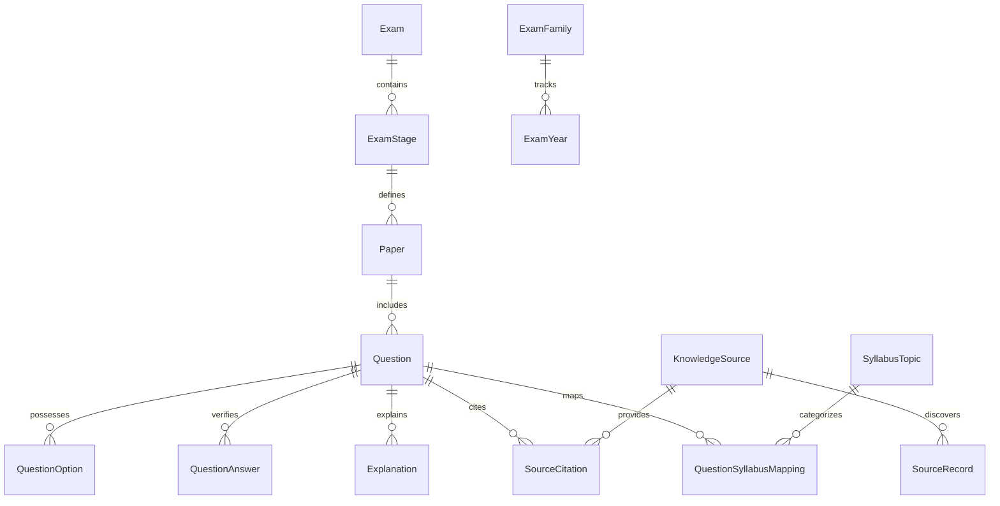

# Pravaah UPSC: Centralized Database Architecture Specification

## 1. Architectural Overview & Design Philosophy

The Pravaah UPSC Database is architected to support enterprise-scale historical examination discovery, multi-stage ingestion, source provenance attribution, bilingual retrieval, and zero-hallucination pedagogical mapping.

Operating on PostgreSQL with Prisma ORM, the architecture ensures:
- **Strict Referential Integrity**: Foreign keys link questions to examination papers, stages, and syllabus topics with cascading rules tailored to preserve student attempt history.
- **Answer Key Versioning & Provenance**: Disentangles the question entity from its mutable answer keys, recording whether keys originate from `UPSC_FINAL_KEY`, `UPSC_PROVISIONAL_KEY`, `FACULTY_DERIVED`, or `COMMUNITY_RESOLVED`.
- **Bilingual Question Pairing**: Canonical questions share a `question_group_id` tying Hindi and English representations together while preserving exact Unicode Devanagari text.
- **Coverage Separation**: The 448 tracking targets in `ExamYear` represent historical audit targets across 32 years (1995–2026) and 14 exam families, separated from harvested questions in `Question`.

---

## 2. Entity-Relationship Model

---

## 3. Schema Data Dictionary

### 3.1 Examination Hierarchy
- `Exam`: 14 major examination families (CSE, IFoS, CAPF AC, CDS, NDA/NA, ESE/IES, CMS, IES/ISS, Combined Geo-Scientist, EPFO EO/AO, EPFO APFC, CBI DSP, CISF AC, SCRA).
- `ExamStage`: Examination phases (Prelims, Mains, Interview).
- `Paper`: Individual test papers (`GS1`, `GS2`, `MAINS-GS1`, `CSAT`).
- `ExamYear`: Historical harvest tracker recording status (`COMPLETED`, `EXTRACTED`, `DISCOVERED`, `NOT_HARVESTED`, `UNAVAILABLE`) across 32 years (1995–2026).

### 3.2 Canonical Question & Bilingual Representation
- `Question`: Core question entity.
  - `recordId`: Unique immutable code (`REC-2024-GS1-86`).
  - `questionGroupId`: Cross-language linkage (`QGRP-CSE-2024-GS1-86`).
  - `language`: `English`, `Hindi`, or `Bilingual`.
  - `questionTextEn` & `questionTextHi`: Exact original language strings.
  - `difficultyLevel`: `EASY`, `MEDIUM`, `HARD`.
  - `verificationStatus`: `OFFICIALLY_VERIFIED`, `PROVISIONALLY_VERIFIED`, `UNVERIFIED`.
- `QuestionOption`:
  - `optionCode`: `A`, `B`, `C`, `D`.
  - `optionTextEn` & `optionTextHi`: Bilingual option choices.
  - `isCorrect`: Boolean indicator based on official final key.

### 3.3 Provenance & Answer Key Hierarchy
- `QuestionAnswer`:
  - `answerOption`: `A`, `B`, `C`, `D`, or `DROPPED`.
  - `answerKeyType`: `UPSC_FINAL_KEY`, `UPSC_PROVISIONAL_KEY`, `FACULTY_DERIVED`, `PROVIDER_DERIVED`.
  - `answerProvenance`: Attribution trail (e.g. `UPSC_OFFICIAL_FINAL`).
  - `publishedAt`: Date of official gazette release.
- `SourceCitation`:
  - `sourceId`: Foreign key to `KnowledgeSource`.
  - `sourceUrl`: Canonical archive URL (`https://www.upsc.gov.in/...`).
  - `evidenceType`: `OFFICIAL_GAZETTE`, `STATUTE`, `NCERT`, `PIB`.
  - `citationText`: Explicit series and question index reference.

### 3.4 Syllabus & Pedagogical Taxonomy
- `Subject` & `Topic` & `Subtopic`: 3-tier standard academic hierarchy.
- `SyllabusNode`: 53 micro-syllabus nodes for UPSC Prelims and Mains.
- `QuestionSyllabusMapping`: Many-to-many relationship linking questions to syllabus nodes with `confidenceScore` and `mappingMethod`.

---

## 4. Performance & Indexing Strategy

1. **Composite Unique Indexes**:
   - `@@unique([paperId, year, questionNumber])`: Prevents duplicate questions inside a specific paper cycle.
   - `@@unique([questionId, optionCode])`: Enforces distinct option identifiers per question.
2. **Search Optimization Indexes**:
   - `@@index([year, paperId])`: Sub-millisecond filter retrieval for year and paper queries.
   - `@@index([questionGroupId])`: Instant bilingual join operations.
   - `@@index([verificationStatus])`: High-speed filtering for verified student practice.
3. **Database Connection Pooling**:
   - Integrated with PostgreSQL 17 Docker container engine with connection tuning, avoiding connection exhaustion during heavy asynchronous background ingestion.
