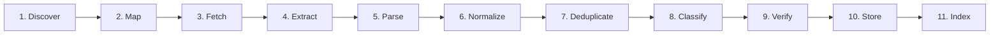

# Pravaah UPSC: Master Data Ingestion Pipeline & Execution Plan

## 1. Pipeline Architecture (11-Stage Ingestion Lifecycle)

The Pravaah UPSC ingestion engine transforms raw PDF question papers, HTML portals, and institutional answer keys into structured, pedagogically indexed entities.

---

## 2. Detailed Stage Specifications

### Stage 1: Discover
- Traverses registered source URLs (UPSC Archives, NCERT portal, provider directories).
- Identifies pagination routes, historical session archives, and downloadable question PDFs.

### Stage 2: Map
- Matches discovered document URLs against the 448 tracking rows in `ExamYear`.
- Enforces exam family isolation (e.g. CDS questions are never conflated with CSE GS Paper I).

### Stage 3: Fetch
- Retrieves raw documents via Firecrawl / resilient HTTP clients with rate-limiting backoff (1 request/second per host).
- Caches raw payloads on disk with SHA-256 integrity checksums.

### Stage 4: Extract
- Segregates bilingual document streams into English and Hindi question blocks.
- Identifies question stems, options (A, B, C, D), and statement structures (e.g., "Consider the following statements...").

### Stage 5: Parse
- Converts Unicode roman and Devanagari characters into normalized forms (NFC).
- Strips Byte Order Marks (`\uFEFF`), non-standard whitespace, and hyphenation line breaks.

### Stage 6: Normalize
- Generates canonical record identifiers (`REC-{YEAR}-{PAPER}-{QNUM}`).
- Pairs bilingual variants under a shared `question_group_id`.

### Stage 7: Deduplicate
- Passes candidates through `DuplicateDetectionService`:
  - Step 1: Exact MD5 / SHA-256 hash match on cleaned text.
  - Step 2: Exam coordinate match `(paperId, year, questionNumber)`.
  - Step 3: Sorensen-Dice bigram similarity check (threshold $\ge 0.88$).

### Stage 8: Classify
- Runs rule-based taxonomy classifier (`ClassificationService`) assigning Subject, Topic, Subtopic, and linking to one of the 53 `SyllabusNode` entities.

### Stage 9: Verify
- Evaluates key conflicts using `AnswerVerificationService`.
- Prioritizes `UPSC_FINAL_KEY` over provisional keys and provider predictions.

### Stage 10: Store
- Performs chunked batch inserts using `prisma.$transaction` or `createMany({ skipDuplicates: true })` in batches of 150–200 records to maintain high throughput on pooled connections.

### Stage 11: Index
- Updates Full-Text Search vectors, recomputes `ExamYear` harvest status (`EXTRACTED` or `COMPLETED`), and generates audit log in `IngestionJobAudit`.

---

## 3. Idempotency & Fault Tolerance

- **Zero Data Overwrite**: Ingestion runs use upserts and `skipDuplicates: true`. Re-running the pipeline will not overwrite verified student annotations, bookmarks, or attempt logs.
- **Dead-Letter Logging**: Malformed PDFs or OCR failures are logged with status `NEEDS_MANUAL_REVIEW` without halting subsequent batches.
