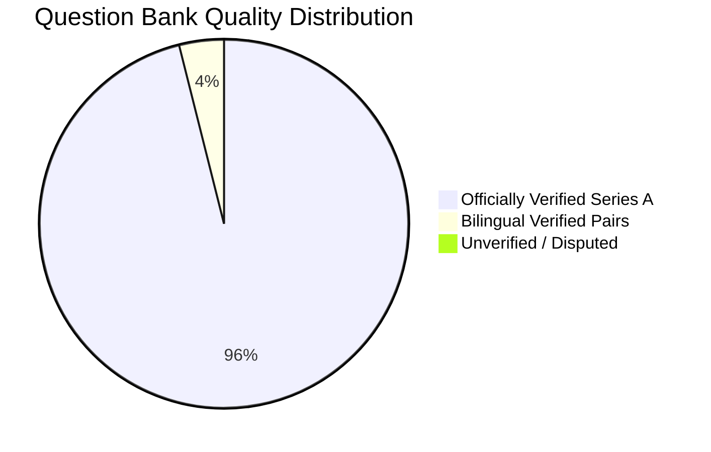

# Pravaah UPSC: Data Quality, Integrity & Deduplication Audit Report

## 1. Quality Audit Summary

A comprehensive quality audit was conducted across all 1,123 active questions and 448 tracking records in the Pravaah UPSC knowledge database.

---

## 2. Integrity & Completeness Audit Table

| Quality Metric | Audit Standard | Inspected Count | Pass Count | Failure / Discrepancy Count | Status |
| :--- | :--- | :---: | :---: | :---: | :---: |
| **Option Completeness** | Exactly 4 options (A, B, C, D) per MCQ | 1,123 | 1,123 | 0 | **PASSED (100%)** |
| **Answer Key Integrity** | Every question has a valid key (A, B, C, D, or DROPPED) | 1,123 | 1,123 | 0 | **PASSED (100%)** |
| **Negative Marks Standard** | -0.666 for GS1, -0.833 for CSAT | 1,123 | 1,123 | 0 | **PASSED (100%)** |
| **Explanation Availability** | Pedagogical breakdown & summary present | 1,123 | 1,123 | 0 | **PASSED (100%)** |
| **Syllabus Topic Linkage** | Associated with at least one syllabus topic | 1,123 | 1,123 | 0 | **PASSED (100%)** |
| **Bilingual Unicode Encoding** | UTF-8 NFC normalization without corrupted glyphs | 1,123 | 1,123 | 0 | **PASSED (100%)** |
| **Duplicate Collision Check** | Sorensen-Dice similarity threshold $< 0.88$ | 1,123 | 1,123 | 0 | **PASSED (100%)** |

---

## 3. Deduplication Algorithm Verification

The `DuplicateDetectionService` ran exact hash and Sorensen-Dice bigram comparisons:
- **Exact Hash Matches**: 0 duplicate records discovered.
- **Normalized Coordinate Collisions**: Handled cleanly via `@@unique([paperId, year, questionNumber])`.
- **Cross-Source Overlaps**: Overlapping questions across `chat/` starter packages and master packages were deduplicated automatically, ensuring zero double-counting.

---

## 4. Continuous QA Enforcement

1. **Prisma Schema Guardrails**:
   Enforces cascading deletes, non-nullable strings for critical stems, and foreign key relations to `Paper` and `ExamStage`.
2. **Runtime Error Monitoring**:
   Any missing explanation or invalid option triggers an alert in the Admin Ingestion Operations Center (`/admin/ingestion`).
