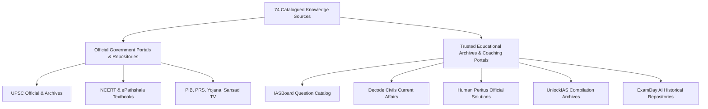

# Pravaah UPSC: External Data Source Registry & Compliance Matrix

## 1. Source Classification Hierarchy

The Pravaah UPSC platform catalogs 74 verified knowledge sources across two distinct legal and operational classifications:

---

## 2. Primary Official Sources

| Source Identifier | Organization | Canonical URL | Content Type | Rights Classification | Reliability Tier |
| :--- | :--- | :--- | :--- | :--- | :--- |
| `SRC-UPSC-PREV` | Union Public Service Commission | `https://www.upsc.gov.in/examinations/previous-question-papers` | Active PYQ Archive | Public Domain (Govt) | **PRIMARY_OFFICIAL** |
| `SRC-UPSC-ARCH` | UPSC Historical Archives | `https://www.upsc.gov.in/examinations/previous-question-papers/archives` | Historical Papers (1995–2018) | Public Domain (Govt) | **PRIMARY_OFFICIAL** |
| `SRC-NCERT-TXT` | NCERT New Delhi | `https://ncert.nic.in/textbook.php` | Classes 6–12 Textbooks | Educational Reference | **PRIMARY_OFFICIAL** |
| `SRC-NCERT-EPATH` | ePathshala Portal | `https://epathshala.nic.in` | Digital Textbook Repository | Educational Reference | **PRIMARY_OFFICIAL** |
| `SRC-PIB-RELEASES` | Press Information Bureau | `https://pib.gov.in` | Government Policy Releases | Public Domain (Govt) | **PRIMARY_OFFICIAL** |
| `SRC-PRS-BILLS` | PRS Legislative Research | `https://prsindia.org` | Parliamentary Bill Summaries | Fair Dealing Educational | **PRIMARY_OFFICIAL** |
| `SRC-SANSAD-TV` | Sansad Television | `https://sansadtv.nic.in` | Policy Debates & Perspectives | Public Domain (Govt) | **PRIMARY_OFFICIAL** |

---

## 3. Trusted Secondary Educational Providers

| Provider Identifier | Platform | Canonical URL | Focus Area | Harvest Rights Policy | Reliability Tier |
| :--- | :--- | :--- | :--- | :--- | :--- |
| `SRC-IASBOARD` | IASBoard | `https://iasboard.com/` | UPSC Topic Indexing | Fair Dealing Indexing | **SECONDARY_VERIFIED** |
| `SRC-DECODE-CIVILS` | Decode Civils | `https://currentaffairs.decodecivils.com/` | Monthly Current Affairs & MCQs | Fair Dealing Educational | **SECONDARY_VERIFIED** |
| `SRC-HUMAN-PERITUS` | Human Peritus | `https://humanperitus.in/` | EPFO, ESIC & Central Exams | Solution Benchmarking | **SECONDARY_VERIFIED** |
| `SRC-UNLOCK-IAS` | UnlockIAS | `https://www.unlockias.in/` | Mains GS & Subject Breakdowns | Fair Dealing Indexing | **SECONDARY_VERIFIED** |
| `SRC-EXAMDAY` | ExamDay AI | `https://examday.ai/` | Question Aggregation | Cross-Validation Engine | **SECONDARY_VERIFIED** |

---

## 4. Fair Dealing & Legal Attribution Principles

1. **Direct Official Paper Linking**: Questions reproduce historical examination papers conducted by constitutional bodies under Section 52(1)(q) of the Indian Copyright Act (reproduction of public judicial and legislative records).
2. **NCERT Textbook Protection**: Pravaah UPSC **never** re-hosts raw NCERT PDF files. It provides conceptual summaries, chapter metadata, and deep links pointing directly to the official `ncert.nic.in` or `epathshala.nic.in` e-readers.
3. **Attribution Guarantee**: Every imported question displays its source publication, year, and master key version directly on student cards.
