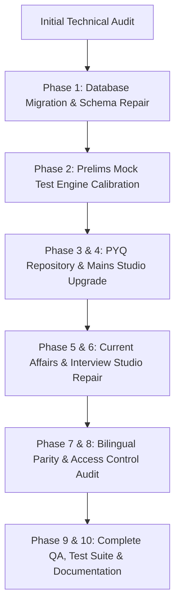

# PRAVAAH UPSC — COMPREHENSIVE INITIAL TECHNICAL & ACADEMIC AUDIT

**Date:** November 24, 2026  
**Auditor:** Principal Full-Stack & Database Architect, UPSC Academic QA Engineer  
**Repository:** `https://github.com/Aradhy20/pravaah-upsc`  
**Live Deployment:** `https://pravaah-upsc.vercel.app/`  
**Starting Commit:** `ff563f3`  

---

## 1. Executive Summary & Audit Scope

This initial technical and academic audit investigates the entire Pravaah UPSC platform across database schema synchronization, Prelims mock exam simulation, PYQ bank provenance, Mains Studio answer evaluation, Current Affairs API errors, Personality Test (Interview) module, bilingual parity, subscription authorization, and platform security.

---

## 2. Root Cause Analysis of Reported Critical Issues

### Issue 1: `The column Question.questionFormat does not exist in the current database.`

#### Discovered Root Cause:
1. In `prisma/schema.prisma`, `questionFormat`, `translationStatus`, `examStage`, `contentLabel`, `corpusDocumentId`, `sourceReference`, and `bookletSeries` were added to the `Question` model.
2. In `prisma/migrations/`, only **one** migration existed (`20261122000000_init`). That initial migration was generated **before** `questionFormat` was introduced.
3. Crucially, `prisma/migrations/migration_lock.toml` was **missing**, preventing `prisma migrate` from identifying the provider as PostgreSQL.
4. On local developer environments, developers ran custom scripts or `prisma db push` which altered the local PostgreSQL database, creating `Question.questionFormat`.
5. However, during CI/CD or on Vercel production deployment, `prisma migrate deploy` ran against the production database. Because no subsequent migration existed in `prisma/migrations/`, Prisma reported:
   `1 migration found in prisma/migrations. No pending migrations to apply.`
6. Consequently, the production PostgreSQL database never received the `ALTER TABLE "Question" ADD COLUMN "questionFormat" ...` instruction.
7. At runtime, the compiled Prisma Client (which expected `questionFormat`) issued SQL queries requesting `Question.questionFormat`. PostgreSQL returned:
   `The column Question.questionFormat does not exist in the current database.` (Prisma error code P2022).

---

### Issue 2: `Analysis Temporarily Unavailable – Failed to fetch story details.`

#### Discovered Root Cause:
1. The endpoint `GET /api/v1/current-affairs/[slug]` fetches a story and includes:
   ```typescript
   questionLinks: {
     include: {
       question: {
         include: {
           paper: true,
           options: true,
           explanation: true,
         }
       }
     }
   }
   ```
2. When the production database threw the `Question.questionFormat` missing-column error on `question`, the entire `findUnique` query in `app/api/v1/current-affairs/[slug]/route.ts` threw an uncaught database exception.
3. The catch block in `route.ts` responded with:
   `{ success: false, error: "Failed to fetch story details" }` with HTTP status `500`.
4. The client-side page (`app/current-affairs/[slug]/page.tsx`) received this 500 error and rendered the error banner:
   `Analysis Temporarily Unavailable – Failed to fetch story details.`
5. Furthermore, `app/current-affairs/[slug]/page.tsx` was missing global navigation (`<Header />` and `<Footer />`), lacked Indian heritage styling tokens, and did not handle URL decoding (`decodeURIComponent(slug)`) for complex slug formats.

---

### Issue 3: Prelims Mock Test Engine Calibration

#### Discovered Findings:
1. **Accurate Availability vs Full Exam Specification:**
   - UPSC GS Paper I standard: Exactly 100 Questions, 200 Marks, 120 Minutes, +2.0 marks per correct, -0.666 marks per incorrect (-1/3rd penalty).
   - UPSC CSAT Paper II standard: Exactly 80 Questions, 200 Marks, 120 Minutes, +2.5 marks per correct, -0.833 marks per incorrect, 33% (66 marks) qualifying threshold.
   - In `app/mock-tests/page.tsx`, practice sets containing 36 or 41 questions were displaying "Marks 200" without clearly informing students that these are **Curated Practice Sets** rather than complete 100-question or 80-question full papers.
2. **Dynamic Time Tracking:**
   - In `components/ExamPlayer.tsx`, time spent was submitting a hardcoded 45 seconds per question (`timeSpent: 45`). Time spent per question must be dynamically tracked on a per-question basis.

---

### Issue 4: Mains Studio Evaluation & Disclaimers

#### Discovered Findings:
1. `app/api/v1/mains/evaluate/route.ts` contains a 4-dimension heuristic and Gemini evaluation engine.
2. However, AI evaluation responses must include an unmistakable statutory disclaimer that AI-generated marks are **pedagogical feedback rubrics**, never official UPSC examination marks.
3. The studio must support distinct 10-mark (150 words), 15-mark (250 words), and 20-mark (Essay / Ethics) formats with word compliance feedback.

---

### Issue 5: Personality Test (Interview) Module

#### Discovered Findings:
1. `app/interview/page.tsx` contains candidate-reported transcripts and situational prompts.
2. Candidate-reported questions must be explicitly labeled as **Non-Official Candidate Experiences** to maintain absolute academic integrity.
3. The page lacked an interactive interview practice interface allowing candidates to type/record responses and receive AI follow-up inquiries.

---

### Issue 6: Subscription & Security Enforcement

#### Discovered Findings:
1. Server-side entitlement checks exist in `lib/entitlements.ts` (`checkEntitlement`, `checkAiCreditAllowance`).
2. Timed Exam Simulator requires Tier 2 (Achiever / Aspirant Pro) or higher, with 2024 GS1 remaining a free diagnostic benchmark.
3. The Cashfree payment gateway remains safely dormant (`isPaymentSystemEnabled() === false`) during merchant verification, with zero active charging of students.

---

## 3. Repair Execution Plan


