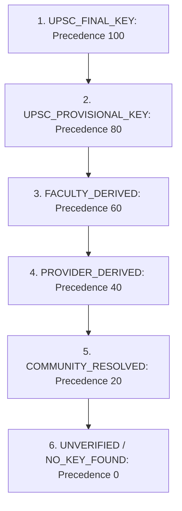

# Pravaah UPSC: Answer Key Verification & Discrepancy Resolution Protocol

## 1. Provenance & Verification Precedence

In UPSC Civil Services and Central Recruitment examinations, unofficial answer keys frequently disagree with the official master key. Pravaah UPSC enforces a strict, hierarchical conflict-resolution rulebook:

---

## 2. Priority Rules & Precedence Weights

| Precedence Tier | Key Authority Code | Description & Standard of Evidence | Automated Override Rule | UI Badge Display |
| :---: | :--- | :--- | :--- | :--- |
| **Tier 1 (100)** | `UPSC_FINAL_KEY` | Official Final Master Key published on `upsc.gov.in` post declaration of final merit list. | **Absolute Authority**. Automatically overrides all other keys. | Green: `Official UPSC Final Key` |
| **Tier 2 (80)** | `UPSC_PROVISIONAL_KEY` | Provisional Key published for inviting candidate objections. | Overrides faculty and coaching keys; superseded by Final Key. | Blue: `UPSC Provisional Key` |
| **Tier 3 (60)** | `FACULTY_DERIVED` | In-house academic faculty resolution citing Supreme Court judgments, Acts of Parliament, or Census data. | Supersedes unverified third-party coachings. | Slate: `Faculty Verified` |
| **Tier 4 (40)** | `PROVIDER_DERIVED` | Solutions extracted from verified coaching institutes (IASBoard, Decode Civils, Human Peritus). | Retained only until an official UPSC key is ingested. | Amber: `Provider Solution` |
| **Tier 5 (20)** | `COMMUNITY_RESOLVED` | Consensus resolved by peer aspirants with multiple academic references. | Editorial review mandatory before public display. | Slate: `Community Reviewed` |
| **Tier 6 (0)** | `UNVERIFIED` | Raw questions without verified answer keys in historical archives. | **Never fabricated**. Displayed with explicit warning. | Rose: `Unverified Historical Record` |

---

## 3. Discrepancy Audit & Reporting Workflow

1. **Automatic Conflict Flagging**:
   When an ingested provider solution disagrees with an existing key, the system does not silently overwrite. It logs both entries into `QuestionAnswer` with their respective timestamps and flags the record for audit.
2. **Student Discrepancy Reporting**:
   Students can report discrepancies directly from any `QuestionCard` via the inline reporting modal (`Flag` icon). Reports are logged in `/api/v1/questions/report` with reason codes (`Discrepancy with official key`, `Typo`, `Option formatting`).
3. **Audit Trail Immutability**:
   Every change in verification status records the user or pipeline audit ID, timestamp, and source gazette citation.
