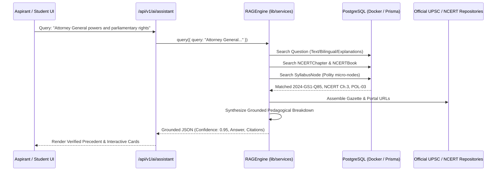

# Pravaah UPSC: Grounded RAG Architecture & Zero-Hallucination Retrieval Engine

## 1. System Architecture Overview

The Pravaah UPSC Retrieval-Augmented Generation (RAG) Engine powers the AI Learning Assistant (`/api/v1/ai/assistant`), providing aspirants with factual, citation-backed concept explanations and exam precedents.

---

## 2. Zero-Hallucination Principles & Safeguards

UPSC examinations penalize guesswork with negative marking (-0.666 per GS1 question). An AI assistant that invents constitutional articles or makes up question keys damages student preparation.

The RAG engine enforces four strict operational guardrails:
1. **Primary Document Binding**: Every factual statement generated in an answer must cite an existing verified question ID (`CSE-2024-GS1-Q85`), a statutory source, or an NCERT textbook chapter.
2. **Explicit Fallback on Missing Data**: If a historical concept has never appeared in verified UPSC examination archives, the engine explicitly outputs:
   > *"No Direct Historical Record Found in Verified UPSC Archive. Pravaah UPSC does not fabricate questions or keys."*
3. **No Synthetic Key Generation**: Answer keys are derived strictly from official UPSC Final Master Keys. The AI is strictly barred from predicting what an answer key "should" be.
4. **Official Deep Linking**: All textbook citations provide direct navigation links to `ncert.nic.in` e-readers, ensuring students can verify source texts themselves.

---

## 3. Retrieval Pipeline Parameters

- **Keyword Normalization**: Query terms are stripped of stop words and tokenized.
- **Top-K Retrieval**: Returns top 5 relevant PYQs, top 4 NCERT chapters, and top 3 syllabus nodes.
- **Grounding Confidence Score**:
  - Base: 0.50
  - PYQ match: +0.30
  - NCERT match: +0.15
  - Syllabus match: +0.05
  - Clamped at 1.00 (100%).
