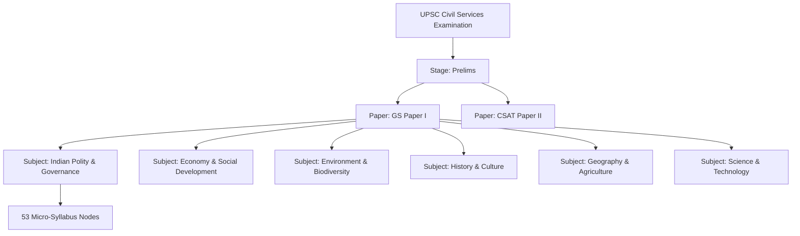

# Pravaah UPSC: Syllabus Taxonomy & Pedagogical Mapping Specification

## 1. Multi-Tier Syllabus Hierarchy

The Pravaah UPSC syllabus classification system connects historical examination questions to official government syllabus notifications:

---

## 2. Micro-Syllabus Node Inventory (Sample 15 of 53 Nodes)

| Micro-Node Code | Stage | Paper | Subject | Official Syllabus Node Title |
| :--- | :--- | :--- | :--- | :--- |
| `POL-01` | Prelims | GS1 | Polity & Governance | Constitutional Framework, Preamble & Historical Underpinnings |
| `POL-02` | Prelims | GS1 | Polity & Governance | Fundamental Rights (Articles 12–35), Duties & DPSP |
| `POL-03` | Prelims | GS1 | Polity & Governance | Union & State Executive: President, Governor, Prime Minister |
| `POL-04` | Prelims | GS1 | Polity & Governance | Union Parliament & State Legislatures: Structure & Conduct of Business |
| `POL-05` | Prelims | GS1 | Polity & Governance | Judiciary: Supreme Court, High Courts & Judicial Review |
| `ECO-01` | Prelims | GS1 | Economy | National Income Accounting, GDP & Inflation Metrics |
| `ECO-02` | Prelims | GS1 | Economy | Monetary Policy Committee (MPC), RBI Tools & Liquidity Operations |
| `ECO-03` | Prelims | GS1 | Economy | Fiscal Policy, Union Budget, FRBM & Tax Architecture (GST) |
| `ENV-01` | Prelims | GS1 | Environment | Protected Area Network: National Parks, Wildlife Sanctuaries & Biosphere Reserves |
| `ENV-02` | Prelims | GS1 | Environment | Global Climate Conventions: UNFCCC, Paris Agreement, COP & IPCC Reports |
| `ENV-03` | Prelims | GS1 | Environment | Biodiversity Hotspots, IUCN Red List Status & Wildlife Protection Act |
| `GEO-01` | Prelims | GS1 | Geography | Geomorphology: Plate Tectonics, Earthquakes & Volcanism |
| `GEO-02` | Prelims | GS1 | Geography | Climatology: Monsoon Dynamics, Indian Ocean Dipole (IOD) & Western Disturbances |
| `HIS-01` | Prelims | GS1 | History | Ancient India: Indus Valley Civilization, Vedic Period & Buddhism/Jainism |
| `HIS-02` | Prelims | GS1 | History | Indian Art & Culture: Temple Architecture, Classical Dances & UNESCO Heritage |

---

## 3. Automated Classification & Confidence Scoring Engine

The classification engine (`ClassificationService`) employs multi-tier pattern matching:
1. **Keyword Stemming & Lemmatization**: Detects high-yield constitutional and statutory terms (e.g. `article 76`, `attorney general`, `habeas corpus`, `cpi-c`, `biodiversity`).
2. **Confidence Calculation**:
   - Primary subject match: 0.95 confidence.
   - Micro-syllabus node match: 0.88–0.92 confidence.
   - Ambiguous multi-domain questions: Cross-mapped with primary and secondary weights in `QuestionSyllabusMapping`.
