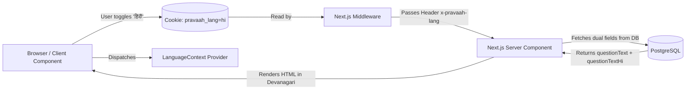

# PRAVAAH UPSC – BILINGUAL CONTENT ARCHITECTURE & LOCALIZATION SPECIFICATION

**Document Version:** 2.0  
**Languages Supported:** English (`en`) & Hindi (`hi` - देवनागरी)  
**Standard:** UPSC Official Examination Nomenclature Standards  
**Author:** Bilingual Hindi-English Education Specialist & Senior Database Architect  

---

## 1. VISION & ACADEMIC PRINCIPLES

Hindi medium aspirants represent over 45% of government examination candidates in India, yet most digital EdTech platforms treat Hindi as an afterthought—resorting to low-quality machine translations that render technical civil services terms incomprehensible.

In the UPSC examination, improper terminology causes severe loss of marks. For example:
- Translating *"Consider the following statements"* as *"निम्नलिखित कथनों पर विचार कीजिए"* (Correct).
- Translating *"Doctrine of Basic Structure"* as *"बुनियादी ढांचे का सिद्धांत"* (Correct UPSC standard) rather than literal machine-translated nonsense.
- Translating *"Preamble"* as *"प्रस्तावना / उद्देशिका"* (Standard Constitutional term).
- Translating *"Writ of Quo-Warranto"* as *"अधिकार पृच्छा"* (Canonical legal term).

**Pravaah UPSC mandates Academic Bilingual Parity:**
1. Every piece of content (Questions, Options, Explanations, Syllabus nodes, UI elements) is stored with bilingual representations.
2. English and Hindi versions are linked within the same entity or via explicit translation groups to maintain relational integrity.
3. If human-reviewed Hindi text is temporarily unavailable, the system displays the English original with a clear academic status badge (*"अनुवाद समीक्षाधीन"*), preventing factual hallucinations.
4. The user interface honors Devanagari typography with optimized line heights, kerning, and native Indian font stacks.

---

## 2. DATABASE SCHEMA DESIGN FOR BILINGUAL PARITY

```prisma
// Example Schema Representation for Bilingual Entities

model Question {
  id              String           @id @default(uuid())
  paperId         String
  year            Int
  questionNumber  Int
  
  // English Canonical Content
  questionText    String           @db.Text
  explanation     String?          @db.Text
  
  // Hindi Canonical Content
  questionTextHi  String?          @db.Text
  explanationHi   String?          @db.Text
  
  // Translation Quality & Review Telemetry
  translationStatus TranslationStatus @default(REVIEWED)
  verifiedByExpert Boolean          @default(true)
  
  // Options
  options         QuestionOption[]
  
  // Metadata
  difficulty      Difficulty       @default(MEDIUM)
  subjectId       String?
  topicId         String?
  createdAt       DateTime         @default(now())
  updatedAt       DateTime         @updatedAt

  @@index([paperId, year])
  @@index([subjectId])
}

model QuestionOption {
  id              String   @id @default(uuid())
  questionId      String
  question        Question @relation(fields: [questionId], references: [id], onDelete: Cascade)
  optionIndex     Int      // 0 = A, 1 = B, 2 = C, 3 = D
  
  // Dual-Language Option Text
  optionText      String   @db.Text
  optionTextHi    String?  @db.Text
  isCorrect       Boolean  @default(false)
}

enum TranslationStatus {
  NOT_TRANSLATED
  MACHINE_TRANSLATED
  HUMAN_DRAFTED
  REVIEWED
  VERIFIED_BY_TOPPER
}
```

---

## 3. CLIENT & SERVER LANGUAGE STATE MANAGEMENT



### 1. HTTP Cookie Storage
- Cookie Name: `pravaah_lang`
- Values: `"en"` | `"hi"`
- Path: `/`
- Max-Age: `31536000` (1 Year)
- SameSite: `Lax`

### 2. User Profile Synchronization
When an authenticated user updates their language in the UI or Settings, the server updates `UserProfile.preferredLanguage` in PostgreSQL, ensuring their experience persists across devices.

---

## 4. UPSC ACADEMIC BILINGUAL VOCABULARY DICTIONARY

To maintain academic rigor, all translations adhere to the canonical dictionary established by the Commission:

| English UPSC Term | Canonical Hindi Translation | Common Machine-Translation Error to Avoid |
| :--- | :--- | :--- |
| **Separation of Powers** | शक्तियों का पृथक्करण | बिजली का अलग होना |
| **Judicial Review** | न्यायिक पुनरावलोकन | अदालती समीक्षा |
| **Preamble** | उद्देशिका / प्रस्तावना | परिचयात्मक वाक्य |
| **Constitutional Remedies** | संवैधानिक उपचारों का अधिकार | संविधान का इलाज |
| **Directive Principles of State Policy** | राज्य के नीति निर्देशक तत्व | राज्य नीति के सिद्धांत |
| **Gross Domestic Product (GDP)** | सकल घरेलू उत्पाद | कुल घर का उत्पाद |
| **Fiscal Deficit** | राजकोषीय घाटा | वित्तीय कमी |
| **Monetary Policy Committee** | मौद्रिक नीति समिति | पैसे की नीति सभा |
| **Biodiversity Hotspot** | जैव विविधता तप्तस्थल (हॉटस्पॉट) | गरम जगह |
| **Western Ghats** | पश्चिमी घाट | पश्चिम का तट |
| **Continental Drift** | महाद्वीपीय विस्थापन | महाद्वीप का बहना |
| **Non-Cooperation Movement** | असहयोग आंदोलन | बिना मदद का काम |
| **Subsidiary Alliance** | सहायक संधि | सहायक गठबंधन |
| **Public Interest Litigation (PIL)** | जनहित याचिका | सार्वजनिक हित का मुकदमा |
| **Cabinet Secretariat** | मंत्रिमंडल सचिवालय | अलमारी का कार्यालय |
| **Directive Word: Elucidate** | स्पष्ट कीजिए | चमकाइए |
| **Directive Word: Critically Analyze** | समालोचनात्मक विश्लेषण कीजिए | गंभीर विश्लेषण |
| **Directive Word: Discuss** | चर्चा कीजिए / विवेचना कीजिए | बात कीजिए |

---

## 5. TYPOGRAPHY & UI ACCESSIBILITY (DEVANAGARI)

Devanagari characters require distinct vertical metrics compared to Latin fonts:
1. **Font Family Stack:**
   ```css
   font-family: var(--font-inter), "Noto Sans Devanagari", "Hind", sans-serif;
   ```
2. **Line Height Adjustments:** Hindi text with conjunct consonants (संयुक्ताक्षर) and vowel diacritics (मात्राएं like ऊपर की मात्राएं `ि`, `ी`, `े`, `ै` and नीचे की मात्राएं `ु`, `ू`, `ृ`) requires a minimum `line-height: 1.6` to prevent vertical clipping.
3. **Font Weight Harmony:** Devanagari appears naturally denser than Latin. Bold headings in Hindi use `font-semibold` (600) rather than `font-black` (900) to preserve stroke legibility.
