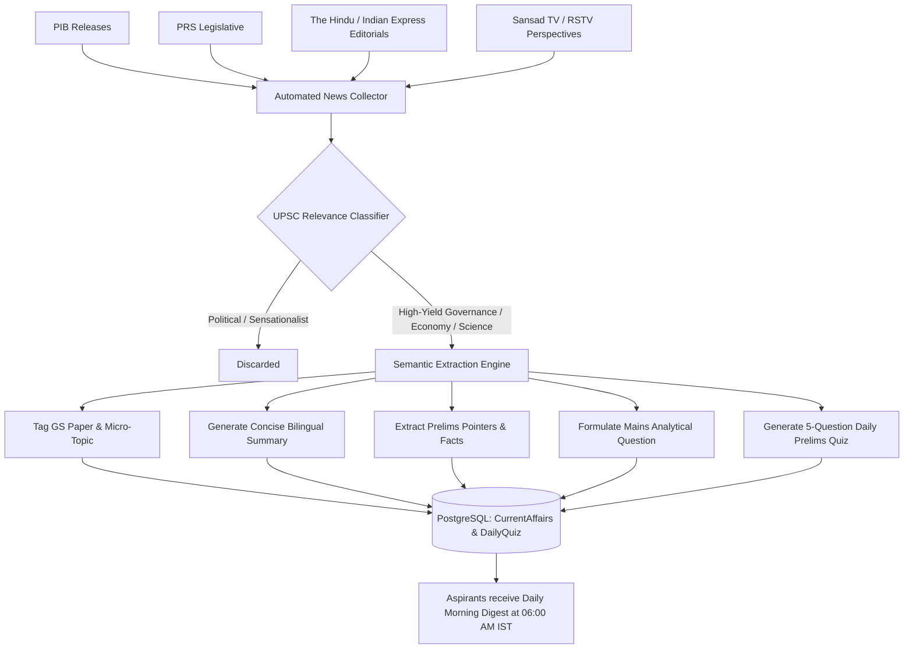

# PRAVAAH UPSC – DAILY CURRENT AFFAIRS & EDITORIAL PIPELINE

**Document Version:** 1.0  
**Target:** Daily News Ingestion, Editorial Deconstruction & Quiz Generation  
**Execution Frequency:** Daily at 04:30 AM IST & 18:00 PM IST  
**Author:** Senior UPSC Faculty & Full-Stack Automation Engineer  

---

## 1. EDITORIAL PHILOSOPHY & UPSC RELEVANCE

The UPSC Civil Services Examination does not test sensationalist or party-political news. It tests **governance, policy implications, constitutional nuances, international treaties, economic trends, environmental agreements, and scientific breakthroughs**.

Traditional aspirants waste 3 to 4 hours daily reading newspapers, often transcribing trivial information. 

**Pravaah UPSC Daily Current Affairs Engine** transforms news into a 15-minute high-yield learning asset:
1. **Multi-Source Aggregation:** Ingests official government releases and leading national dailies.
2. **Strict UPSC Relevance Filter:** Discards political polemics, crime, local municipal news, and sports scores.
3. **Syllabus Tagging:** Automatically links each article to GS Paper 1, 2, 3, or 4 and micro-topics.
4. **Bilingual Synthesis:** Generates synchronized English and Hindi summaries.
5. **Prelims & Mains Synthesis:** Every article outputs:
   - 3–4 High-Yield Prelims Pointers (Key terms, bodies, acts).
   - 1 Analytical Mains Model Question with structured discussion framework.
   - 1 Daily Prelims Practice Question directly derived from the news item.



---

## 2. MONITORED AUTHORITATIVE SOURCES

| Source Name | Category | Content Type | Ingestion Frequency |
| :--- | :--- | :--- | :--- |
| **Press Information Bureau (PIB)** | Official Government Releases | Ministry schemes, Cabinet decisions, bilateral treaties | 3x Daily (08:00, 14:00, 20:00) |
| **PRS Legislative Research** | Parliamentary & Bills | Bill summaries, Law commissions, Committee reports | Daily at 19:00 |
| **The Hindu / Indian Express** | National Dailies | Lead editorials, Op-eds, Explaining Explained | Daily at 05:00 |
| **Down to Earth** | Environment & Ecology | Climate agreements, IUCN status, Forest rights, COP | Weekly & Breaking |
| **Yojana & Kurukshetra** | Rural & Socio-Economic | In-depth developmental governance studies | Monthly on release |
| **Reserve Bank of India (RBI) Bulletins**| Monetary & Financial | Repo rates, inflation frameworks, banking reforms | Fortnightly |

---

## 3. CURRENT AFFAIRS DATA MODEL

```prisma
model CurrentAffairs {
  id              String       @id @default(uuid())
  date            DateTime     @db.Date
  title           String       @db.VarChar(255)
  titleHi         String?      @db.VarChar(255)
  slug            String       @unique
  summary         String       @db.Text
  summaryHi       String?      @db.Text
  content         String       @db.Text
  contentHi       String?      @db.Text
  
  // UPSC Classification
  paper           PaperType    // GS_1, GS_2, GS_3, GS_4
  subjectId       String?
  topicId         String?
  sourceUrl       String?
  sourceName      String       // "PIB", "The Hindu", "PRS", "Indian Express"
  
  // Extracted Academic Modules
  prelimsPointers String[]     // Bullet points for Prelims (Facts, Articles, Species)
  mainsQuestion   String?      @db.Text
  mainsQuestionHi String?      @db.Text
  mainsFramework  String?      @db.Text
  
  // Relations
  dailyQuizQuestions DailyQuizQuestion[]
  
  published       Boolean      @default(true)
  createdAt       DateTime     @default(now())
  updatedAt       DateTime     @updatedAt

  @@index([date])
  @@index([paper])
}
```

---

## 4. DAILY PIPELINE EXECUTION CRON & RUNBOOK

The automated ingestion pipeline runs via GitHub Actions or Node.js scheduler:

```bash
# Manual trigger command for daily current affairs curation:
npm run cron:current-affairs -- --date=today --publish=true
```

### Verification Checklist before Publishing Daily Digest:
1. Does the article connect to at least one explicit line in the UPSC CSE Syllabus?
2. Are all constitutional articles, committee names, and dates verified against official government gazettes?
3. Is the Hindi translation authentic and free from awkward transliterations?
4. Does the generated daily quiz question have unambiguous options and a verified single correct answer?
5. Has the article been linked to relevant historical PYQs to show recurring trends?
