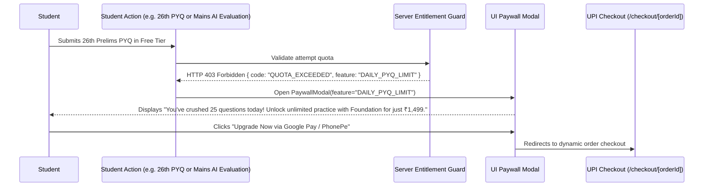

# PRAVAAH UPSC – FEATURE ENTITLEMENT & MONETIZATION MATRIX

**Document Version:** 2.0  
**Status:** Canonical Entitlement Specification  
**Enforcement:** Server-Side Middleware (`lib/entitlements.ts`) & UI Paywall Modal (`components/PaywallModal.tsx`)  
**Author:** Principal SaaS Product Architect & Full-Stack Engineer  

---

## 1. SUBSCRIPTION TIERS OVERVIEW

Pravaah UPSC adopts a transparent, student-friendly 4-tier model with zero hidden fees and no auto-debit traps:

| Tier Identifier | Display Name | Target Aspirant | Monthly Price | Annual / Access Validity |
| :--- | :--- | :--- | :--- | :--- |
| `FREE` | **Explorer (मुफ़्त)** | First-time aspirants exploring UPSC & syllabus | ₹0 | Lifetime |
| `BEGINNER` | **Foundation (आरंभ)** | Beginners building core NCERT & Prelims concepts | ₹499 / mo | ₹1,499 / 6 months |
| `ACHIEVER` | **Pro (संकल्प)** | Serious candidates preparing for Prelims + Mains | ₹999 / mo | ₹3,999 / 1 year |
| `SCHOLAR` | **Ultimate (विजेता)** | Full-cycle aspirants needing intensive AI evaluation | ₹1,499 / mo | ₹7,999 / 2 years (Till Selection) |

---

## 2. GRANULAR FEATURE ENTITLEMENT GRID

| Feature / Capability | Free Explorer | Foundation (Beginner) | Pro (Achiever) | Ultimate (Scholar) | Server-Side Enforcement Key |
| :--- | :---: | :---: | :---: | :---: | :--- |
| **Bilingual UI & Content (English & Hindi)** | Full Access | Full Access | Full Access | Full Access | Always Enabled |
| **Syllabus Knowledge Tree** | Full Access | Full Access | Full Access | Full Access | Always Enabled |
| **Prelims PYQ Practice (1995–2024)** | 25 questions / day | Unlimited | Unlimited | Unlimited | `maxDailyPYQs` (25 vs Infinity) |
| **PYQ Filter by Subject / Year / Topic** | Basic Filters | Advanced Filters | Advanced Filters | Advanced Filters | `advancedFilters` (true/false) |
| **Prelims Detailed Explanations** | Past 3 Years only | Full Archive | Full Archive | Full Archive | `explanationArchiveDepth` |
| **NCERT Textbook & Chapter Questions** | 2 Chapters / Book | Unlimited | Unlimited | Unlimited | `ncertChapterLimit` |
| **Daily Current Affairs Reader** | Today only | 30-Day Archive | Full Year Archive | Unlimited Archive | `currentAffairsArchiveDays` |
| **Daily Practice Quiz** | 5 Qs / day | Unlimited | Unlimited | Unlimited | `dailyQuizUnlimited` |
| **Mock Tests (Full-Length & Sectional)** | 1 Demo Mock Test | 10 Mock Tests / yr | 35 Mock Tests / yr | Unlimited Mock Tests | `mockTestQuota` |
| **Spaced Repetition Revision Queue** | Max 20 cards | Max 200 cards | Unlimited | Unlimited | `maxRevisionCards` |
| **Personalized Study Planner & Roadmap** | Static Roadmap | Adaptive Roadmap | Adaptive Roadmap | Adaptive Roadmap | `adaptivePlanner` |
| **Mains Question Bank (1995–2024)** | View only (5 Qs) | Full Access | Full Access | Full Access | `mainsQuestionAccess` |
| **Mains Answer Workspace & Timer** | Allowed (No AI) | Allowed | Allowed | Allowed | `mainsWorkspaceAllowed` |
| **AI Mains Answer Evaluation (10-Rubric)** | 0 / month (Preview) | 5 answers / month | 30 answers / month | 100 answers / month | `mainsEvaluationMonthlyQuota` |
| **Pravaah AI Mentor (RAG Assistant)** | 10 queries / day | 50 queries / day | 200 queries / day | Unlimited queries | `aiMentorDailyTokens` |
| **Video Academy (Curated Lectures)** | Intro lessons only | Full Access | Full Access | Full Access | `videoAcademyAccess` |
| **Annotated Topper Copy Library** | 3 sample copies | Full Access | Full Access | Full Access | `topperCopyAccess` |
| **Downloadable High-Yield Revision PDFs** | No | 5 PDFs / month | Unlimited | Unlimited | `pdfDownloadAllowed` |
| **Priority Expert / Faculty Doubt Review**| No | Community forum | Priority queue | Dedicated Mentor Review | `mentorSupportLevel` |

---

## 3. SERVER-SIDE ENFORCEMENT IMPLEMENTATION

Entitlements are strictly evaluated server-side. The client cannot bypass feature locks by manipulating frontend state.

```typescript
// Location: lib/entitlements.ts
export interface UserEntitlement {
  tier: "FREE" | "BEGINNER" | "ACHIEVER" | "SCHOLAR";
  maxDailyPYQs: number;
  advancedFilters: boolean;
  explanationArchiveDepthYears: number;
  mainsEvaluationMonthlyQuota: number;
  aiMentorDailyQueries: number;
  mockTestQuota: number;
  maxRevisionCards: number;
  adaptivePlanner: boolean;
  videoAcademyAccess: boolean;
  topperCopyAccess: boolean;
  pdfDownloadAllowed: boolean;
}

export const TIER_LIMITS: Record<string, UserEntitlement> = {
  FREE: {
    tier: "FREE",
    maxDailyPYQs: 25,
    advancedFilters: false,
    explanationArchiveDepthYears: 3,
    mainsEvaluationMonthlyQuota: 0,
    aiMentorDailyQueries: 10,
    mockTestQuota: 1,
    maxRevisionCards: 20,
    adaptivePlanner: false,
    videoAcademyAccess: false,
    topperCopyAccess: false,
    pdfDownloadAllowed: false,
  },
  BEGINNER: {
    tier: "BEGINNER",
    maxDailyPYQs: Infinity,
    advancedFilters: true,
    explanationArchiveDepthYears: 30,
    mainsEvaluationMonthlyQuota: 5,
    aiMentorDailyQueries: 50,
    mockTestQuota: 10,
    maxRevisionCards: 200,
    adaptivePlanner: true,
    videoAcademyAccess: true,
    topperCopyAccess: true,
    pdfDownloadAllowed: true,
  },
  ACHIEVER: {
    tier: "ACHIEVER",
    maxDailyPYQs: Infinity,
    advancedFilters: true,
    explanationArchiveDepthYears: 30,
    mainsEvaluationMonthlyQuota: 30,
    aiMentorDailyQueries: 200,
    mockTestQuota: 35,
    maxRevisionCards: Infinity,
    adaptivePlanner: true,
    videoAcademyAccess: true,
    topperCopyAccess: true,
    pdfDownloadAllowed: true,
  },
  SCHOLAR: {
    tier: "SCHOLAR",
    maxDailyPYQs: Infinity,
    advancedFilters: true,
    explanationArchiveDepthYears: 30,
    mainsEvaluationMonthlyQuota: 100,
    aiMentorDailyQueries: Infinity,
    mockTestQuota: Infinity,
    maxRevisionCards: Infinity,
    adaptivePlanner: true,
    videoAcademyAccess: true,
    topperCopyAccess: true,
    pdfDownloadAllowed: true,
  },
};
```

---

## 4. UPGRADE CONVERSION TRIGGERS (PAYWALL MODAL FLOW)

When a student reaches an entitlement boundary, the application does not crash or display an unhelpful error. It triggers the **Pravaah Paywall Modal**:


