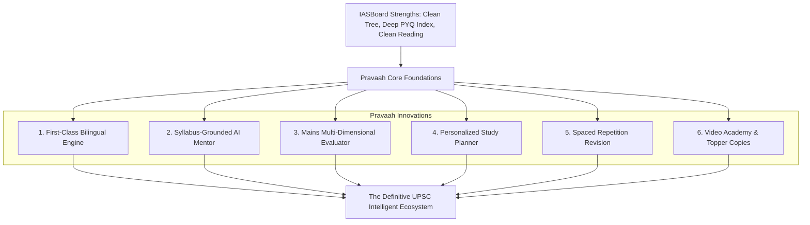

# PRAVAAH UPSC vs. IASBOARD – STRATEGIC COMPETITIVE ANALYSIS & PRODUCT BENCHMARK

**Audit Date:** November 21, 2026  
**Product:** Pravaah UPSC (https://pravaah-upsc.vercel.app/)  
**Reference Platform:** IASBoard (https://iasboard.com/)  
**Document Classification:** Product Strategy & SaaS Positioning  
**Author:** Principal SaaS Product Architect & UPSC Academic Strategist  

---

## 1. EXECUTIVE SUMMARY & BENCHMARKING OBJECTIVE

IASBoard is one of the most respected and cleanly architected UPSC digital preparation platforms in India. It is renowned for its **exhaustive Prelims and Mains topic indexing**, clean navigation, and structured catalog of syllabus-aligned previous year questions.

However, IASBoard operates primarily as a **static resource directory and structured question index**. 

**Pravaah UPSC** is engineered to be a **dynamic, bilingual, intelligent preparation ecosystem**. While Pravaah incorporates the best structural patterns of IASBoard (syllabus hierarchy, paper breakdown, and tagged questions), it solves the five fundamental pain points where IASBoard and traditional portals fall short:

1. **Passive vs. Active Learning:** IASBoard shows questions; Pravaah tests, diagnoses, times, evaluates, and schedules spaced revision for them.
2. **Monolingual vs. First-Class Bilingual:** IASBoard is overwhelmingly English-centric; Pravaah provides seamless, culturally authentic, simultaneous Hindi and English access.
3. **Static Content vs. Real-Time AI Mentorship:** IASBoard provides fixed answer keys; Pravaah provides an integrated, syllabus-grounded AI Mentor that dissects answers, clarifies nuances, and assesses student writing.
4. **Generic vs. Personalized Path:** IASBoard gives every aspirant the same page; Pravaah dynamically adapts study plans based on diagnostic onboarding, accuracy telemetry, and weak subject detection.
5. **Disconnected Tools vs. Unified Ecosystem:** Aspirants currently read on IASBoard, watch lectures on YouTube, practice tests on a third site, and submit Mains answers via Telegram; Pravaah consolidates this entire pipeline into one unified SaaS workflow.

---

## 2. IN-DEPTH 10-DIMENSION COMPARATIVE MATRIX

| Dimension | IASBoard (iasboard.com) | Pravaah UPSC (pravaah-upsc.vercel.app) | Pravaah Competitive Advantage & Strategic Moat |
| :--- | :--- | :--- | :--- |
| **1. Information Architecture & Navigation** | Clean, minimalist, hierarchical tree of papers and topics. Easy to browse. | Modern Next.js 15 App Router with collapsible Syllabus Knowledge Tree, breadcrumbs, search, and quick switcher. | **Interactive Knowledge Graph:** Pravaah connects each syllabus node directly to PYQs, NCERT chapters, video lectures, and current affairs. |
| **2. PYQ Indexing & Granularity** | Deeply tagged by GS Paper, Subject, and Micro-topic. Prelims and Mains clearly separated. | Micro-topic tagging down to sub-themes, plus filtering by Difficulty, Exam Stage, Year (1995–2024), and Exam Family (CSE, CAPF, CDS, EPFO). | **Multi-Exam Coverage & Analytical Telemetry:** Pravaah tracks accuracy per micro-topic and shows historical trend patterns (e.g., rising weightage of Environment or CSAT). |
| **3. Mains Preparation & Answer Evaluation** | Displays past Mains questions with basic model points or topper copy references. No submission or automated feedback. | Dedicated Mains Workspace with split-screen question, official syllabus anchor, timer, word counter, and **AI-powered 10-Dimension Rubric Evaluation**. | **Actionable Feedback Loop:** Instant evaluation assessing Introduction, Core Content, Multi-dimensional Analysis, Diagrams, Constitutional provisions, and Examiner recommendations. |
| **4. Current Affairs & Daily Editorial** | Daily compilation of news summaries with basic topic tagging. Static reading experience. | Curated Daily Current Affairs with **Syllabus Tagging (GS1-4)**, Prelims Pointers, Mains Discussion Questions, and auto-generated Daily 5-question Quizzes. | **Direct Daily Synthesis:** Students don't just read news; they immediately practice Prelims questions and attempt a Mains question derived from today's PIB/editorial. |
| **5. Bilingual Parity (Hindi vs English)** | Very limited Hindi coverage; Hindi aspirants must rely on partial translations or separate PDFs. | **First-Class Bilingual Architecture:** Complete dual-language database schemas, global one-click language toggle, persistent preference, and authentic Devanagari typography. | **Mass Market Demographics:** Over 45% of government exam candidates prefer Hindi medium. Pravaah eliminates the secondary status of Hindi aspirants. |
| **6. Personalization & Adaptive Planning** | None. Pure repository. Every user sees identical content. | **Diagnostic Onboarding & Dynamic Roadmap Engine:** Builds 6-to-18 month milestone schedules tailored to hours/day, target year, and weak subjects. | **Accountability & Retention:** Daily study tasks, completion tracking, streak counters, and automated schedule re-balancing if the student falls behind. |
| **7. AI Mentorship & Doubt Resolution** | None. Static FAQs and fixed discussion links. | **Pravaah AI Mentor (Bilingual RAG):** Grounded strictly in official UPSC syllabus, NCERT texts, and standard references. Cites authoritative sources. | **24/7 Personal Faculty:** Answers conceptual queries, breaks down complex judgment doctrines (e.g., Basic Structure), and suggests relevant PYQs. |
| **8. Video & Visual Learning Ecosystem** | No integrated video player; external links if any. | **Curated Video Academy:** High-yield video lectures categorized by GS paper and micro-topic, paired with lesson transcripts, notes, and related PYQs. | **Frictionless Learning:** Students watch a 20-minute concept video and immediately solve the 5 previous year questions asked on that exact topic. |
| **9. Topper Copy Intelligence** | Static PDF links to topper answer scripts hosted on external drives. | **Interactive Topper Answer Library:** Searchable by Topper Name, Rank, Year, and Optional Subject, with annotated callouts of structuring, diagrams, and high-scoring techniques. | **Pedagogical Deconstruction:** Teaches students *why* an answer scored 11/15 rather than just showing a scan. |
| **10. Monetization & Entitlements** | Ad-supported or opaque subscription models with high paywalls. | **Transparent Value Tiering:** Clear Free (Explorer), Beginner (₹1,499), Achiever (₹3,999), and Scholar (₹7,999) tiers with instant UPI checkout and entitlement security. | **Accessible Pricing:** High-end UPSC coaching costs ₹1,50,000–₹2,50,000. Pravaah offers institutional-grade preparation at an accessible fraction. |

---

## 3. FEATURE GAP CLOSURE STRATEGY

To surpass IASBoard definitively, Pravaah UPSC is executing the following upgrades:

### Gap 1: Topic-Level Breadth vs. Topic-Level Interactivity
- **IASBoard approach:** Clicking "Fundamental Rights" shows 15 past questions with static text.
- **Pravaah transformation:** Clicking "Fundamental Rights" in Pravaah reveals:
  - Theoretical concept summary and official syllabus mapping (GS2: Indian Constitution).
  - Linked NCERT chapters (Class 11 Political Theory & Indian Constitution at Work).
  - All Prelims PYQs with timed practice mode, instant explanation, and peer accuracy percentage.
  - All Mains PYQs with model answer structures and option to type/upload answers for AI grading.
  - 1 curated concept video from Video Academy.
  - 2 annotated Topper answer copies illustrating how Rank 1 structured this exact question.

### Gap 2: Hindi Medium Neglect in Current EdTech
- **IASBoard approach:** English-first with incidental Hindi.
- **Pravaah transformation:** 
  - Standardized Hindi civil services vocabulary (e.g., "मूल अधिकार", "समान नागरिक संहिता", "भू-आकृतिक प्रक्रियाएं").
  - Hindi audio-visual support in Video Academy.
  - Dual-medium question toggle: Students can view question in Hindi or English mid-test with zero reset.

---

## 4. PRODUCT DIFFERENTIATION SUMMARY

1. **Not just a Question Bank:** Pravaah is an adaptive learning system that closes the loop between **reading -> testing -> feedback -> revision**.
2. **Pedagogically Rigorous:** Built around the actual UPSC evaluation standards (Directive words: Discuss, Critically Analyze, Elucidate, Examine; GS1-4 rubric; negative marking telemetry).
3. **Inclusive:** Democratizing access for non-metro, working professional, and Hindi-medium aspirants who cannot afford Old Rajinder Nagar coaching institutes.
