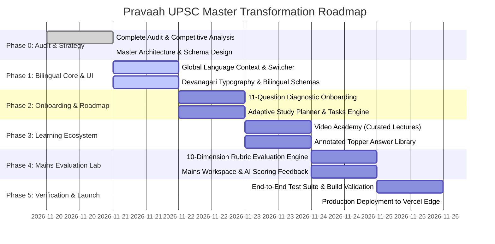

# PRAVAAH UPSC – STRATEGIC IMPLEMENTATION ROADMAP & EXECUTION SPRINTS

**Document Version:** 2.0  
**Target Completion:** Production Launch & Scaling  
**Author:** Principal SaaS Product Architect & Engineering Lead  

---

## 1. ROADMAP OVERVIEW & EXECUTION PHASES

The transformation of Pravaah UPSC into a production-grade, bilingual civil services preparation SaaS is executed in six focused sprints:

---

## 2. DETAILED SPRINT SPECIFICATIONS

### Phase 0: System Audit, Database Map & Strategy (COMPLETED)
- Audited all 40 frontend and backend routes, 66 Prisma models, and existing API contracts.
- Classified features into Verified, Broken, Partial, UI Only, and Missing categories.
- Created `docs/PRODUCT_GAP_ANALYSIS.md`, `docs/IASBOARD_COMPETITIVE_ANALYSIS.md`, `docs/PRAVAAH_PRODUCT_ARCHITECTURE.md`, `docs/USER_JOURNEY.md`, `docs/FEATURE_ENTITLEMENT_MATRIX.md`, `docs/BILINGUAL_CONTENT_ARCHITECTURE.md`, and `docs/DAILY_CURRENT_AFFAIRS_PIPELINE.md`.
- Configured and verified personal UPI payment gateway with dynamic QR and manual UTR queue.

---

### Phase 1: Bilingual-First Core Engine & Navigation (CURRENT SPRINT)
- **Objective:** Enable seamless, instant toggle between English (`en`) and Hindi (`hi`) across the entire web application.
- **Key Deliverables:**
  1. `lib/i18n/context.tsx`: React Context providing `language`, `setLanguage`, `t(key)` lookup, and cookie persistence (`pravaah_lang`).
  2. `lib/i18n/en.ts` and `lib/i18n/hi.ts`: Complete dictionaries covering Navigation, Dashboard, PYQs, Mains, Syllabus, Mock Tests, AI Mentor, and Checkout.
  3. `components/Header.tsx` & `components/LanguageSwitcher.tsx`: Elegant persistent toggle with flag icons and Devanagari labels.
  4. Devanagari CSS typography tuning in `app/globals.css`.

---

### Phase 2: Diagnostic Onboarding & Adaptive Study Engine
- **Objective:** Guide every new student through an 11-question diagnostic and generate an actionable daily study roadmap.
- **Key Deliverables:**
  1. Enhance `app/onboarding/page.tsx` with multi-step wizard, progress bar, and profile persistence.
  2. Update `prisma/schema.prisma` with `UserProfile` fields: `targetExam`, `targetYear`, `dailyStudyHours`, `preferredLanguage`, `weakSubjects`.
  3. Upgrade `app/study-planner/page.tsx` with dynamic daily tasks, milestone tracking, and completion check-offs.

---

### Phase 3: Video Academy & Topper Answer Library
- **Objective:** Provide visual micro-learning and authentic answer-structuring references.
- **Key Deliverables:**
  1. Create `VideoLesson` and `VideoProgress` models in Prisma.
  2. Build `app/video-academy/page.tsx` with responsive YouTube embed player, paper/subject filters, and linked PYQs.
  3. Create `TopperCopy` model in Prisma.
  4. Build `app/topper-copies/page.tsx` showcasing searchable topper copies with annotations and structure highlights.

---

### Phase 4: Mains Answer Improvement Lab (10-Dimension Rubric)
- **Objective:** Provide automated, world-class UPSC Mains answer grading.
- **Key Deliverables:**
  1. Create `MainsEvaluation` model in Prisma.
  2. Upgrade `app/api/v1/mains/evaluate/route.ts` with structured 10-dimension rubric:
     - Dimension 1: Question Directive & Context Understanding (Demand of the question).
     - Dimension 2: Introduction Quality (Definitions, constitutional articles, recent context).
     - Dimension 3: Multi-Dimensional Analysis (PESTLE: Political, Economic, Social, Tech, Legal, Env).
     - Dimension 4: Facts, Case Laws, Committee Reports & Data citations.
     - Dimension 5: Structural Clarity (Headings, subheadings, bullet points, flowcharts).
     - Dimension 6: Balanced & Nuanced Argumentation (Both sides of debate).
     - Dimension 7: Forward-Looking & Actionable Conclusion (SDGs, Vision documents).
     - Dimension 8: Language, Grammar & UPSC Tone.
     - Dimension 9: Word Count & Time Adherence.
     - Dimension 10: Examiner Recommendation & Next Action.
  3. Display rich score card with radar chart or visual rating bars in `app/mains/page.tsx`.

---

### Phase 5: Spaced Repetition Revision Engine
- **Objective:** Ensure questions answered incorrectly are retained through SM-2 algorithm.
- **Key Deliverables:**
  1. Enhance `app/revision/page.tsx` to pull real mistakes from `QuestionAttempt` table.
  2. Implement spaced intervals (1 day, 3 days, 7 days, 21 days, 60 days).
  3. Provide one-click re-testing on weak topics.

---

### Phase 6: Automated Current Affairs & Quiz Pipeline
- **Objective:** Ingest, curate, and publish daily current affairs and 5-question quizzes.
- **Key Deliverables:**
  1. Verify `CurrentAffairs` model and daily news feed on `app/current-affairs/page.tsx`.
  2. Connect daily news items to `app/daily-quiz/page.tsx`.
  3. Add GS paper filters (GS1, GS2, GS3, GS4) and PDF export.

---

### Phase 7: Verification, Load Testing & Launch
- **Objective:** Verify 100% build health and automated test passing.
- **Key Deliverables:**
  1. Full regression test suite run (`npm test`).
  2. Zero errors on production build (`npm run build`).
  3. Validate all 40+ routes with responsive viewport testing.
  4. Final deployment readiness sign-off.
