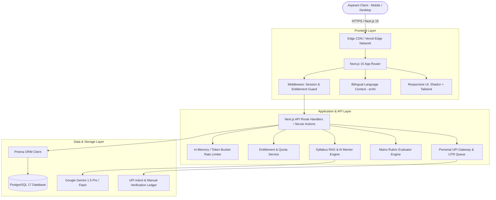

# PRAVAAH UPSC – SYSTEM & PRODUCT ARCHITECTURE SPECIFICATION

**Document Version:** 2.0  
**Status:** Approved for Implementation  
**Target Environment:** Production (Vercel Edge + Dedicated PostgreSQL / Local Docker)  
**Author:** Principal SaaS Product Architect & DevSecOps Engineer  

---

## 1. ARCHITECTURAL OVERVIEW & DESIGN PRINCIPLES

Pravaah UPSC is engineered as a high-performance, bilingual, modular SaaS platform utilizing modern web engineering standards:
- **Next.js 15 (App Router)** for hybrid static generation (SSG), incremental static regeneration (ISR), and dynamic server rendering.
- **React 19 & Tailwind CSS** for responsive, mobile-first, and accessible (a11y) interfaces.
- **PostgreSQL 17** managed via **Prisma ORM** with custom database indexes, full-text search vectors, and relational integrity.
- **Bilingual Core Architecture** supporting real-time switching between English (`en`) and Hindi (`hi`) with zero layout shift.
- **AI & RAG Engine** powered by Google Gemini 1.5 Pro / Flash models grounded in authoritative UPSC syllabus nodes and NCERT embeddings.
- **Multi-Tenant Entitlement Engine** enforcing granular feature access (`FREE`, `BEGINNER`, `ACHIEVER`, `SCHOLAR`).
- **Resilient UPI Payment Processing** featuring dynamic intent creation, manual UTR verification queues, and audit logging.



---

## 2. REPOSITORY & DIRECTORY STRUCTURE

The repository adheres strictly to Next.js 15 App Router modular architecture:

```
pravaah-upsc/
├── app/                                  # App Router Routes & Page Handlers
│   ├── (auth)/                           # Authentication routes (login, register)
│   ├── admin/                            # Secure Admin Console
│   │   ├── data-integrity/               # Live DB duplicate audit & coverage metrics
│   │   ├── payments/                     # Financial telemetry & Manual UTR Queue
│   │   └── users/                        # User management & role control
│   ├── api/v1/                           # Versioned REST APIs
│   │   ├── admin/                        # Admin endpoints (payments, verifications)
│   │   ├── ai/                           # AI Mentor & RAG endpoints
│   │   ├── auth/                         # NextAuth / session management
│   │   ├── current-affairs/              # Daily editorial & news endpoints
│   │   ├── mains/                        # Mains questions & rubric evaluation
│   │   ├── mock-tests/                   # Test engine & attempt submission
│   │   ├── ncert/                        # NCERT books & chapter questions
│   │   ├── payments/                     # Order generation & UTR submission
│   │   ├── pyqs/                         # Prelims question bank query & search
│   │   ├── revision/                     # Spaced repetition queue endpoints
│   │   ├── syllabus/                     # Official syllabus hierarchy
│   │   ├── topper-copies/                # Annotated topper answers
│   │   └── videos/                       # Curated Video Academy lessons
│   ├── checkout/[orderId]/               # Student UPI checkout & QR page
│   ├── current-affairs/                  # Daily current affairs reader & quiz
│   ├── daily-quiz/                       # Daily Prelims practice quiz
│   ├── dashboard/                        # Student analytics, streak & recommendations
│   ├── mains/                            # Mains writing workspace & evaluation
│   ├── mock-tests/                       # Mock test series catalogue & player
│   ├── ncert/                            # NCERT textbook library & questions
│   ├── onboarding/                       # Diagnostic student onboarding wizard
│   ├── pricing/                          # Transparent pricing & plan comparison
│   ├── pyqs/                             # Filterable Prelims question bank
│   ├── revision/                         # Spaced repetition revision lab
│   ├── study-planner/                    # Adaptive study roadmap & daily tasks
│   ├── syllabus/                         # Interactive syllabus knowledge tree
│   ├── topper-copies/                    # Curated topper copy library
│   ├── video-academy/                    # Topic-wise curated video lessons
│   ├── layout.tsx                        # Root layout with Bilingual & Auth providers
│   ├── page.tsx                          # High-conversion UPSC landing page
│   └── globals.css                       # Design tokens, typography & CSS variables
├── components/                           # Reusable UI Components
│   ├── Header.tsx                        # Global navigation with Language & Auth controls
│   ├── Footer.tsx                        # Educational footer with quick links & badges
│   ├── LanguageSwitcher.tsx              # English / Hindi toggle with persistent storage
│   ├── PaywallModal.tsx                  # Dynamic entitlement upgrade modal
│   ├── AIMentorWidget.tsx                # Floating / docked AI assistant
│   └── ui/                               # Atomic primitives (Button, Card, Badge, Modal)
├── lib/                                  # Shared Libraries & Business Logic
│   ├── auth.ts                           # NextAuth configuration & callbacks
│   ├── db.ts                             # Singleton Prisma client instance
│   ├── entitlements.ts                   # Role & tier gating engine
│   ├── i18n/                             # Bilingual dictionary & translation context
│   │   ├── context.tsx                   # React Context for language state
│   │   ├── en.ts                         # English strings & terminology
│   │   └── hi.ts                         # Hindi strings & UPSC terminology
│   ├── payments/                         # Payment subsystem
│   │   └── upi-gateway/                  # Personal UPI config, order & verification
│   └── rag/                              # Syllabus grounding & AI evaluation prompts
├── prisma/                               # Database schema & migrations
│   ├── schema.prisma                     # Complete multi-tenant UPSC schema
│   └── migrations/                       # Deterministic SQL migrations
├── public/                               # Static assets (logos, icons, illustrations)
└── tests/                                # Automated unit, integration & E2E tests
```

---

## 3. DATABASE DESIGN & ENTITY RELATIONSHIPS

The database schema is organized into five tightly coupled domains:

### Domain 1: Identity, Roles & Entitlements
- `User`: Primary account record with `roleId`, `status`, and relations to payments and attempts.
- `Role`: RBAC definitions (`STUDENT`, `FACULTY`, `ADMIN`).
- `UserProfile`: Student demographics, `targetExam`, `targetYear`, `dailyStudyHours`, `preferredLanguage` (`en` | `hi`), `weakSubjects`, and `readinessIndex`.
- `Subscription`: Active plan tier (`FREE`, `BEGINNER`, `ACHIEVER`, `SCHOLAR`), start/end dates, and status.

### Domain 2: Academic Knowledge Base
- `Exam`: Top-level examination family (e.g., `UPSC_CSE`, `CAPF_AC`, `CDS`, `EPFO`).
- `Stage`: Examination stage (`PRELIMS`, `MAINS`, `INTERVIEW`).
- `Paper`: Specific exam paper (e.g., `GS_1`, `GS_2`, `GS_3`, `GS_4`, `CSAT`, `ESSAY`).
- `Subject`: Subject domain (e.g., `POLITY`, `HISTORY`, `ECONOMY`, `GEOGRAPHY`, `ETHICS`).
- `SyllabusNode`: Hierarchical tree node containing official syllabus text, code, and parent-child pointers.
- `Topic` & `Subtopic`: Granular academic mapping units connecting questions, videos, and NCERT chapters.

### Domain 3: Question Bank & Practice
- `Question`: Core question entity. Contains English and Hindi texts (`questionText`, `questionTextHi`), explanation (`explanation`, `explanationHi`), difficulty (`EASY`, `MEDIUM`, `HARD`), official year, question number, and verified answer key.
- `QuestionOption`: Multiple choice options with dual-language support (`optionText`, `optionTextHi`) and correctness flag.
- `QuestionTag`: Semantic linking between questions and syllabus topics.
- `QuestionAttempt`: Individual student answer, time taken, correctness, and timestamp.
- `MainsQuestion`: Subjective question with word limit, marks, analytical framework, and sample answer.
- `MainsEvaluation`: Student submitted answer text/image, scored across 10 rubric dimensions with AI feedback.

### Domain 4: Multimedia & Extended Learning
- `VideoLesson`: Curated high-yield video with title, titleHi, videoId (YouTube), duration, transcript, and topicId.
- `TopperCopy`: Curated sample answers from UPSC toppers (Name, Rank, Year, Optional, PDF/Image URL, annotations).
- `NCERTBook` & `NCERTChapter`: Digital catalog of NCERT textbooks linked to syllabus topics and practice questions.
- `CurrentAffairs`: Daily news analysis with GS tags, Prelims points, and editorial discussion.

### Domain 5: Payments, Transactions & Audit
- `PaymentOrder`: Dynamic order record with `orderId`, `amount`, `currency`, `tier`, `status` (`PENDING`, `PAID`, `REJECTED`, `EXPIRED`).
- `PaymentRecord`: Transaction proof including `utrNumber`, `providerTxId`, payee details, and verification audit trail.
- `AuditLog`: System-wide security and modification ledger tracking administrative actions.

---

## 4. BILINGUAL INTERNATIONALIZATION (i18n) ARCHITECTURE

```mermaid
sequenceDiagram
    participant User as Aspirant
    participant Browser as Browser Client
    participant Cookie as Cookie Storage (pravaah_lang)
    participant NextServer as Next.js Server Component
    participant DB as PostgreSQL

    User->>Browser: Selects "हिंदी" (Hindi)
    Browser->>Cookie: Set cookie 'pravaah_lang=hi; path=/; max-age=31536000'
    Browser->>Browser: Update React Language Context
    Browser->>NextServer: Request /pyqs with Cookie: pravaah_lang=hi
    NextServer->>DB: Query Question with dual fields
    DB-->>NextServer: Return { questionText, questionTextHi, options... }
    NextServer-->>Browser: Render page with Devanagari Hindi text & fonts
    Browser-->>User: Display seamless Hindi experience
```

### Fallback Hierarchy
1. If user preference is `hi`:
   - Display `questionTextHi` if populated and non-empty.
   - If `questionTextHi` is missing, render `questionText` (English) with a subtle indicator: *"हिंदी अनुवाद समीक्षाधीन है / Translation under review"*.
2. If user preference is `en`:
   - Always display canonical English text.
3. Mid-Question Dual View:
   - During mock tests and PYQ practice, an instant toggle allows the student to flip individual questions between English and Hindi to understand difficult terminology.

---

## 5. SECURITY, COMPLIANCE & PERFORMANCE METRICS

- **Input Sanitization & Schema Validation:** All API inputs validated using **Zod** schemas.
- **SQL Injection Prevention:** 100% parameterized queries via Prisma ORM; zero unescaped raw SQL concatenation.
- **Authentication Security:** Secure HTTP-only session cookies with CSRF protection and bcrypt password hashing.
- **Financial Anti-Tamper:** Order amounts are strictly derived from server-side database records; client-submitted pricing is rejected.
- **UTR Anti-Fraud Protection:** Unique constraint on `utrNumber` prevents duplicate submissions; admin manual verification queue ensures human-verified reconciliation for bank transfers.
- **Performance Targets:**
  - TTFB (Time to First Byte): < 150ms on edge cached pages.
  - PYQ Query Latency: < 35ms for 50-item paginated queries with relational joins.
  - Lighthouse Accessibility (a11y) Score: >= 95.
  - Fully responsive across mobile (320px+), tablet, and desktop (4K).
