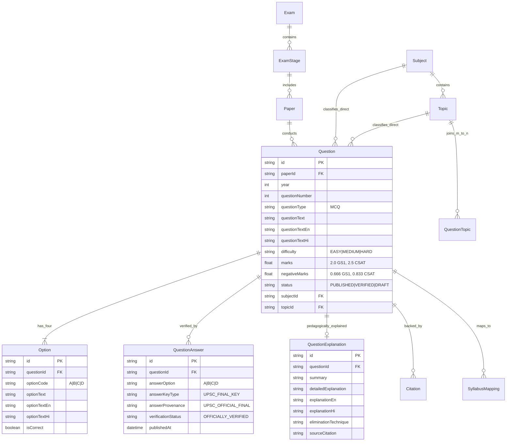

# PRAVAAH UPSC — PRELIMS PYQ DATABASE SCHEMA & ENTITY MAPPING
**Document Reference:** `DOCS-PYQ-SCHEMA-002`  
**Database Engine:** PostgreSQL 17 (Docker Container: `pravaah-db`)  
**ORM:** Prisma 5.22.0  

---

## 1. ENTITY RELATIONSHIP ARCHITECTURE

The PYQ architecture links Examination Hierarchy, Bilingual Question Entities, 24-Subject Academic Taxonomy, Official Verification Keys, and Student Attempt Telemetry:

---

## 2. DIRECT FOREIGN KEYS & QUERY ACCELERATION

To guarantee sub-15ms filtering across 30 years of questions, `Question` maintains direct foreign keys alongside M:N taxonomy tables:

- **`Question.subjectId`**: Direct FK to `Subject.id` indexed via `@@index([subjectId])`.
- **`Question.topicId`**: Direct FK to `Topic.id` indexed via `@@index([topicId])`.
- **Composite Unique Index**: `@@unique([paperId, year, questionNumber])` strictly prevents accidental duplication of any question in the same paper and year.
- **Year & Status Index**: `@@index([year, status])` powers instant year pill retrieval.

---

## 3. MARKING SCHEME METRICS

| Examination Paper | Correct Mark (`marks`) | Negative Penalty (`negativeMarks`) | Penalty Fraction | Passing Threshold |
|---|---|---|---|---|
| **GS Paper 1 (GS1)** | `+2.00` | `-0.666` | 1/3rd of positive | Cut-off based merit (~85–100) |
| **GS Paper 2 (CSAT / GS2)** | `+2.50` | `-0.833` | 1/3rd of positive | Qualifying 33% (66.67 / 200) |

---

## 4. FIELD-BY-FIELD MAPPING SPECIFICATION

| Client Interface Field | Database Source Column | Table | Transformation / Fallback |
|---|---|---|---|
| Question Stem (English) | `questionTextEn` | `Question` | Fallback to `questionText` |
| Question Stem (Hindi) | `questionTextHi` | `Question` | Rendered when language mode = HI or BOTH |
| Option Code | `optionCode` | `Option` | "A", "B", "C", "D" |
| Option Text (English) | `optionTextEn` | `Option` | Fallback to `optionText` |
| Option Text (Hindi) | `optionTextHi` | `Option` | Devanagari text |
| Official UPSC Key | `answerOption` | `QuestionAnswer` | Verified against UPSC final master key |
| Elimination Technique | `eliminationTechnique` | `QuestionExplanation` | Highlights logical trap & elimination heuristics |
| Detailed Explanation | `detailedExplanation` | `QuestionExplanation` | Multi-paragraph conceptual rationale |
| Academic Subject | `name` | `Subject` | Joined via `Question.subjectId` |
| Academic Topic | `name` | `Topic` | Joined via `Question.topicId` |
| Reference Citation | `citationText` / `sourceName`| `Citation` | Official gazette or textbook reference |
