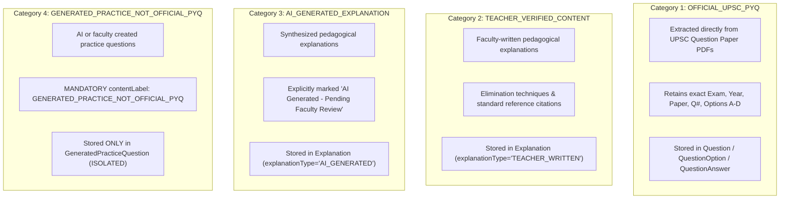

# Question Bank Data Separation & Academic Integrity Policy

**Platform:** Pravaah UPSC SaaS (`https://pravaah-upsc.vercel.app/`)  
**Standard:** ISO/EdTech Content Provenance Standard  
**Enforcement:** Database-Level Constraints & Server-Side Middleware  
**Date:** November 2026  
**Auditor:** Aradhy Jain (+91 7351522153, jainaradhy123@gmail.com)

---

## 1. Core Principles

In UPSC Civil Services preparation, authentic past-year questions are the single most critical diagnostic benchmark for aspirants. Conflating AI-generated practice questions with authentic UPSC questions or fabricating question counts destroys student trust and platform credibility.

Pravaah UPSC implements **four strict content categories**, enforced at the database schema, API query, and user interface layers.

---

## 2. Category Definitions & Technical Rules

### Category 1: `OFFICIAL_UPSC_PYQ`
- **Definition**: A question that was physically printed on an official Union Public Service Commission examination question paper.
- **Requirements**:
  - Must reference a verified `CorpusDocument` ID or document source citation.
  - Must preserve original option letters (`A`, `B`, `C`, `D`).
  - Must carry `contentLabel = 'OFFICIAL_UPSC_PYQ'`.
  - Is included in official PYQ tallies (e.g. 121 Prelims, 32 Mains in production database).

### Category 2: `TEACHER_VERIFIED_CONTENT`
- **Definition**: Explanations, concept notes, elimination techniques, and NCERT / standard book citations authored and verified by human subject-matter experts.
- **Requirements**:
  - Attributed to faculty (`reviewer` or `facultyName`).
  - Stored in `Explanation` with `explanationType = 'TEACHER_WRITTEN'` or `'PEDAGOGICAL'`.
  - `verifiedAt` timestamp populated.

### Category 3: `AI_GENERATED_EXPLANATION`
- **Definition**: Explanations generated by large language models to provide immediate student guidance where human teacher explanations are still pending.
- **Requirements**:
  - Must carry `explanationType = 'AI_GENERATED'`.
  - UI displays an explicit badge: *"AI-assisted explanation — Review in progress"*.
  - Must cite primary sources for factual claims.

### Category 4: `GENERATED_PRACTICE_NOT_OFFICIAL_PYQ`
- **Definition**: Synthetic or practice questions created to test concepts, train specific weak microthemes, or generate mock drills.
- **ABSOLUTE RESTRICTIONS**:
  - **Table Isolation**: Stored exclusively in `GeneratedPracticeQuestion`. NEVER inserted into `Question` or `QuestionStagingRecord`.
  - **Immutable Label**: Every record is forced to carry `contentLabel = 'GENERATED_PRACTICE_NOT_OFFICIAL_PYQ'`.
  - **Zero Count Inflation**: Generated practice questions are mathematically excluded from any metric claiming "Previous Year Questions" or "UPSC Official Questions".
  - **Distinct UI Badge**: When presented to students, questions carry an amber warning: *"Practice Question — Not an Official UPSC PYQ"*.

---

## 3. Official Answer Key Provenance Protocol

1. **Booklet Series Matching**: An official answer key is attached only when the test series / booklet code (`A`, `B`, `C`, `D`) matches the question paper numbering.
2. **Dropped / Changed Questions**:
   - If UPSC drops a question during final evaluation, it is explicitly marked with `answerType = 'DROPPED'` and `officialAnswer = 'DROPPED'`.
   - The question is NOT quietly deleted, altered, or marked with an arbitrary letter key.
3. **Pending Verification**: If an official final key is not yet released for a paper, the key status remains `PENDING_VERIFICATION` or `NO_KEY_FOUND`.
4. **No Answer Guessing**: Automated extractors are forbidden from assigning arbitrary answer letters based on frequency or unofficial coach guesses.
