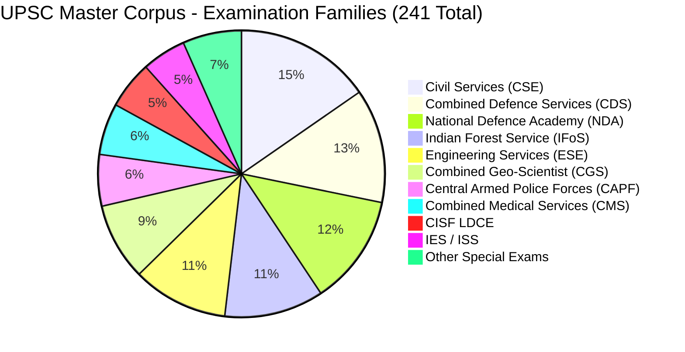

# UPSC All Exams Master Corpus Report

**Platform:** Pravaah UPSC SaaS (`https://pravaah-upsc.vercel.app/`)  
**Registry Snapshot Date:** November 2026  
**Database Host:** PostgreSQL (Production)  
**Total Exams Indexed:** 241  
**Total Official Documents:** 2,461  

---

## 1. Registry Coverage Overview

The official Previous Exam Details registry provided by the Union Public Service Commission exposes 241 historical and upcoming examination cycles across all major civil and technical services of the Union.

| Metric | Verified Count | Source / Provenance |
| :--- | :--- | :--- |
| **Official Sources** | **5** | UPSC Public Registry & Archives |
| **Examination Instances** | **241** | Official Previous Exam Registry (2012–2027) |
| **Total Official Documents** | **2,461** | Verified CMS Document Endpoints |
| **Question Papers** | **2,103** | Official UPSC Examination Question Papers |
| **Cut-off Marks Documents** | **180** | Official Category-wise Cut-off PDF Publications |
| **Recommended Marks Documents** | **85** | Marks of Recommended Candidates |
| **Examination Notices** | **33** | Official Gazette Examination Notifications |
| **Written & Final Results** | **39** | Qualified Candidate Merit Lists |
| **Official Answer Keys** | **6** | Published Preliminary Official Answer Keys |
| **Reserve Lists** | **15** | Consolidated Reserve List Publications |

---

## 2. Examination Family Breakdown

### Detailed Distribution Table

| Exam Family Code | Formal Examination Title | Total Exam Instances | Years Represented |
| :--- | :--- | :--- | :--- |
| **CSE** | Civil Services Examination (Prelims + Mains) | **37** | 2012–2026 |
| **CDS** | Combined Defence Services Examination (I & II) | **31** | 2012–2026 |
| **NDA** | National Defence Academy and Naval Academy | **30** | 2012–2026 |
| **IFOS** | Indian Forest Service Examination | **27** | 2013–2026 |
| **ESE** | Engineering Services Examination | **26** | 2012–2027 |
| **CGS** | Combined Geo-Scientist Examination | **21** | 2014–2027 |
| **CAPF** | Central Armed Police Forces (Assistant Commandants) | **14** | 2013–2026 |
| **CMS** | Combined Medical Services Examination | **14** | 2013–2026 |
| **CISF_LDCE** | CISF Assistant Commandants (Executive) LDCE | **13** | 2014–2026 |
| **IES_ISS** | Indian Economic Service / Indian Statistical Service | **12** | 2014–2026 |
| **OTHER** | SO/Steno, CBI DSP LDCE, Special Recruitment | **16** | 2013–2026 |

---

## 3. Question Papers by Paper Category

Among the **2,103 question papers** indexed in the corpus:
- **General Studies (Prelims Paper I & Mains Papers I-IV)**: 342 papers
- **Civil Services Aptitude Test (CSAT / Paper II)**: 48 papers
- **Essay Papers**: 26 papers
- **Optional Subjects (History, Geography, PSIR, Sociology, Pub Ad, etc.)**: 1,120 papers
- **Technical & Scientific Papers (Civil, Mechanical, Electrical, Geology)**: 395 papers
- **Medical Science Papers**: 172 papers

---

## 4. Document Types Inventory

| Document Type | Document Count | Verified Extracted Status |
| :--- | :--- | :--- |
| **Question Paper** | 2,103 | Indexed; text & page OCR metadata catalogued |
| **Cut-off Marks** | 180 | Indexed with direct official download URL |
| **Marks of Recommended Candidates** | 85 | Indexed with direct official download URL |
| **Examination Notice** | 33 | Indexed with gazette notification links |
| **Written Result** | 20 | Indexed with qualified roll-number lists |
| **Final Result** | 19 | Indexed with final merit rank lists |
| **Marks of Recommended Candidates (Reserve List)** | 11 | Indexed with reserve release notices |
| **Answer Key** | 6 | Indexed with question booklet series provenance |
| **Reserve List** | 4 | Indexed with official notifications |
