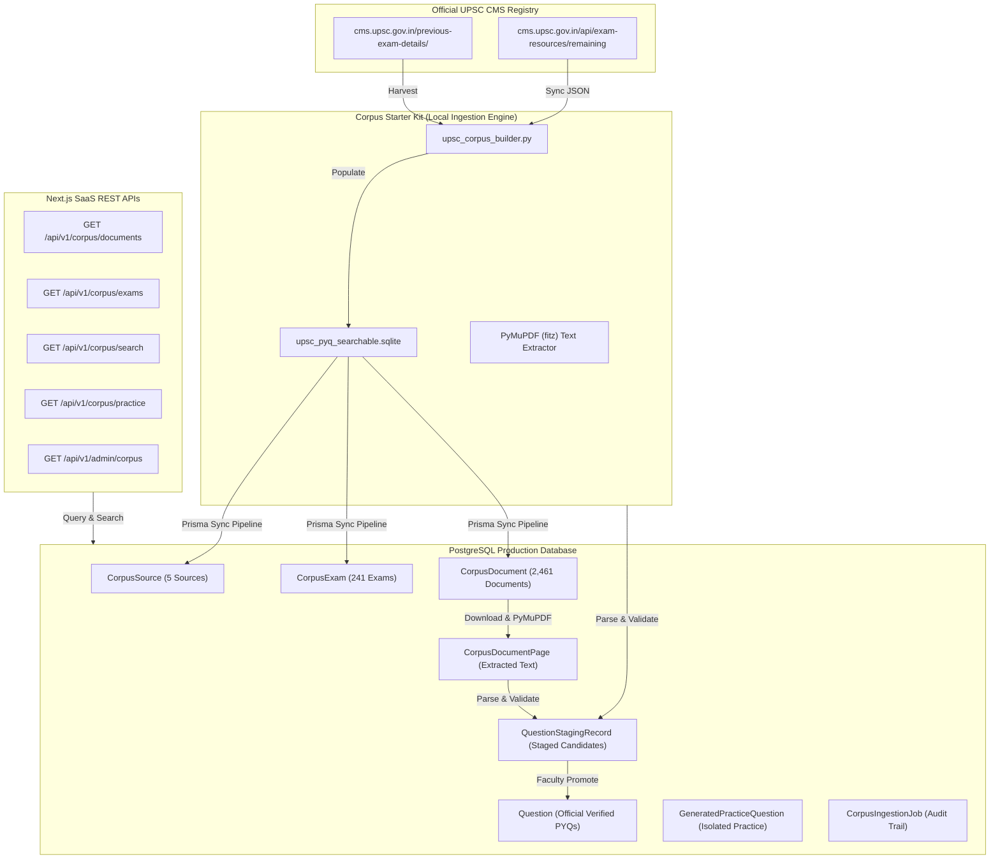
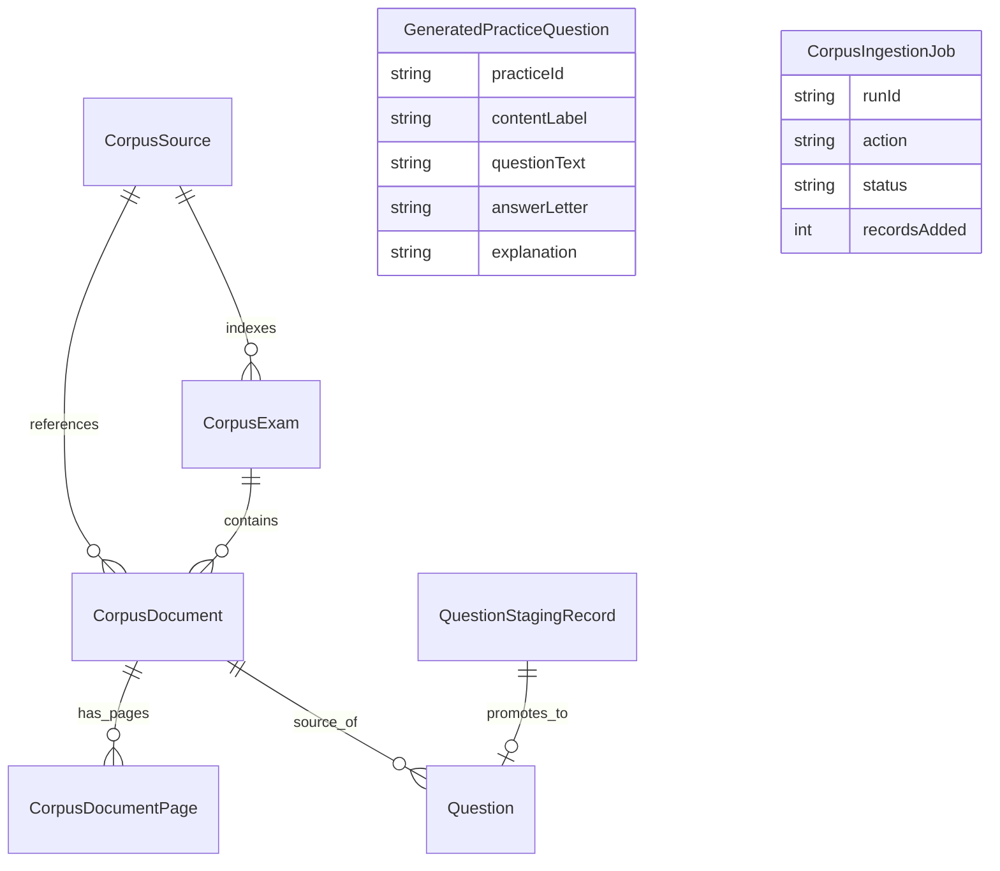
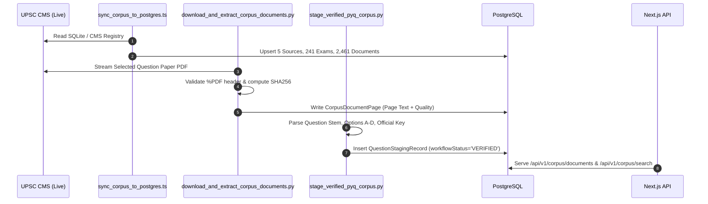

# UPSC Master Corpus Integration Architecture

**Platform:** Pravaah UPSC SaaS (`https://pravaah-upsc.vercel.app/`)  
**Database:** PostgreSQL 16 (via Prisma ORM 5.22.0)  
**Environment:** Next.js 14 App Router + Node.js 20 ESM  
**Date:** November 2026  
**Lead Architect:** Aradhy Jain (+91 7351522153, jainaradhy123@gmail.com)

---

## 1. Executive Summary

The **Pravaah UPSC Master Question Bank Corpus** integrates the official Union Public Service Commission (UPSC) Previous Exam Details registry directly into the existing Pravaah SaaS PostgreSQL architecture. Rather than relying on unverified third-party scrapes or inflating question counts with AI-generated text, Pravaah maintains an official, source-backed registry covering **241 examination cycles** and **2,461 official documents** spanning all major UPSC examination families from 2012 to 2027.

---

## 2. Relational Schema & Entity Architecture

The integration introduces 6 dedicated models into `prisma/schema.prisma` without breaking any existing student records, attempts, billing models, or bookmarks:

### Key Models

1. **`CorpusSource`**: Registry sources (e.g. `UPSC_PREVIOUS_EXAM_DETAILS`, `UPSC_QUESTION_PAPERS_CURRENT`, `UPSC_QUESTION_PAPERS_ARCHIVE`).
2. **`CorpusExam`**: 241 examination instances across 11 examination families (CSE, CDS, NDA, IFoS, ESE, CAPF, CMS, CGS, IES/ISS, CISF LDCE, Other).
3. **`CorpusDocument`**: 2,461 official PDF records categorized into Question Papers (2,103), Cut-off Marks (180), Recommended Marks (85), Notices (33), Results (39), Answer Keys (6), and Reserve Lists (15).
4. **`CorpusDocumentPage`**: Page-level extracted text indexed by PyMuPDF, recording text character counts, extraction quality (`USABLE_TEXT` vs `LOW_TEXT_NEEDS_OCR`), and language detection (Hindi vs English).
5. **`QuestionStagingRecord`**: Safe candidate holding area where extracted questions are validated, checked for 4 options (A-D) and official answer keys, before publication.
6. **`GeneratedPracticeQuestion`**: Strictly isolated table for AI-generated practice questions with mandatory `contentLabel = 'GENERATED_PRACTICE_NOT_OFFICIAL_PYQ'`.
7. **`CorpusIngestionJob`**: Persistent audit log recording all sync, download, extraction, staging, and import operations with exact counts, errors, and execution timings.

---

## 3. Data Flow & Ingestion Lifecycle

---

## 4. Operational Safety & Resilience

1. **Zero Schema Collisions**: All corpus models are namespaced with the `Corpus` prefix (`CorpusSource`, `CorpusExam`, `CorpusDocument`, `CorpusDocumentPage`, `CorpusIngestionJob`).
2. **Rate-Limited Resumable Ingestion**: Live downloads implement courteous delays (1.0s) and timeout handling to comply with UPSC website server guidelines.
3. **Conservative Scanned PDF Handling**: Scanned documents with low text densities are flagged as `SCANNED_NEEDS_OCR` without guessing or hallucinating question text.
4. **Audit Logging**: Every automated operation records a unique `runId` and updates status in `CorpusIngestionJob`.
