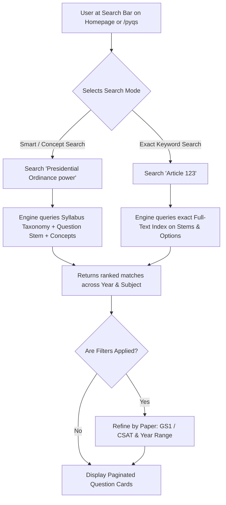
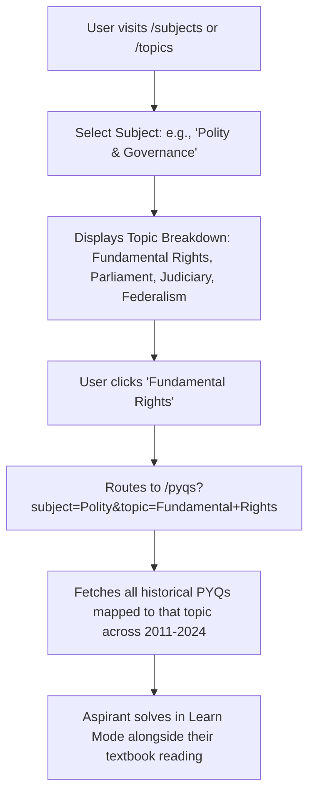
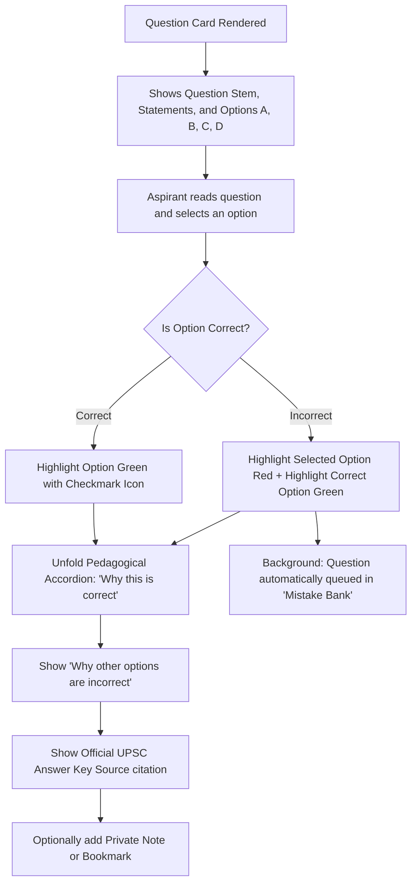
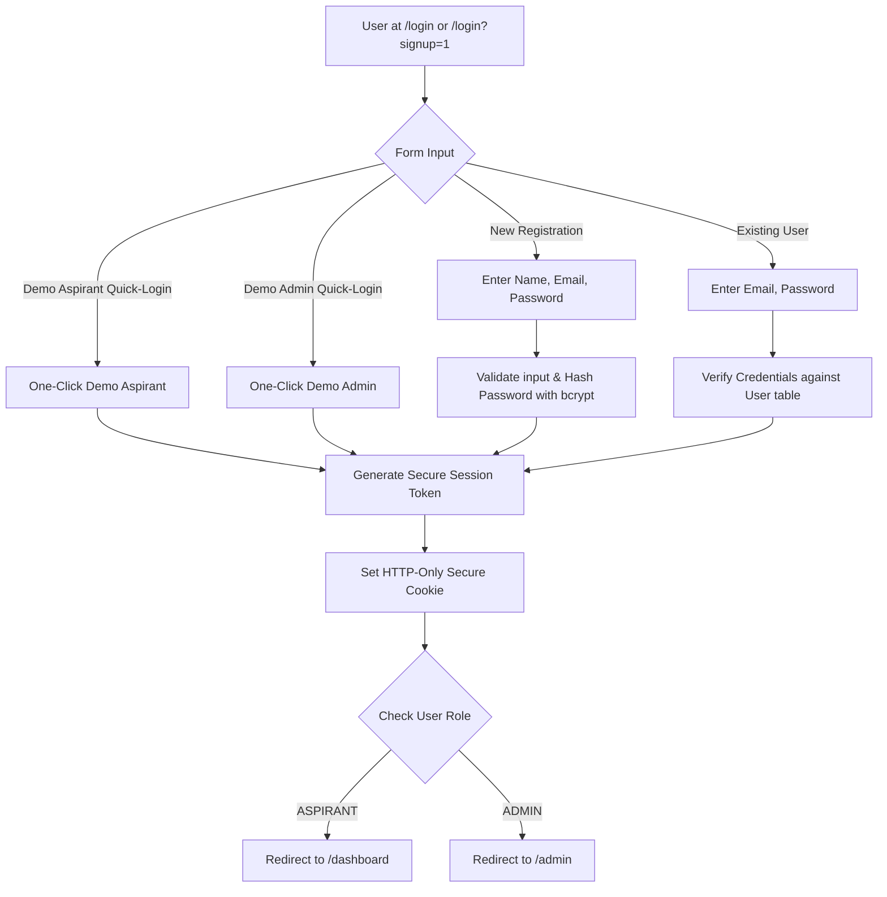
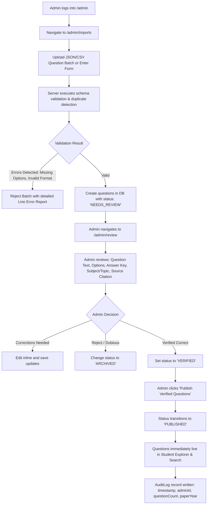
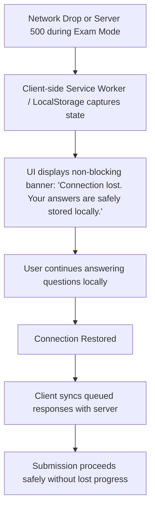
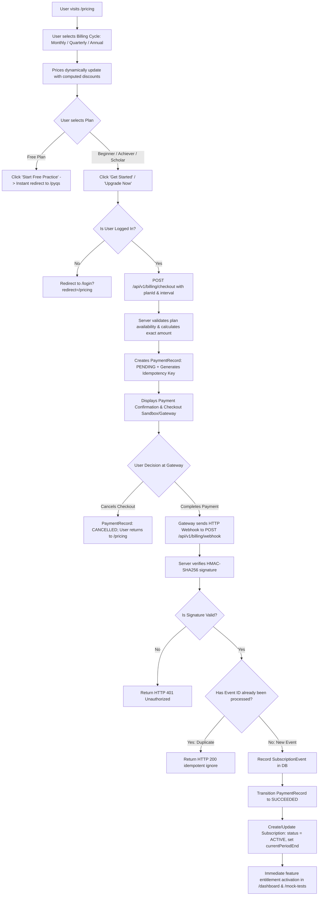
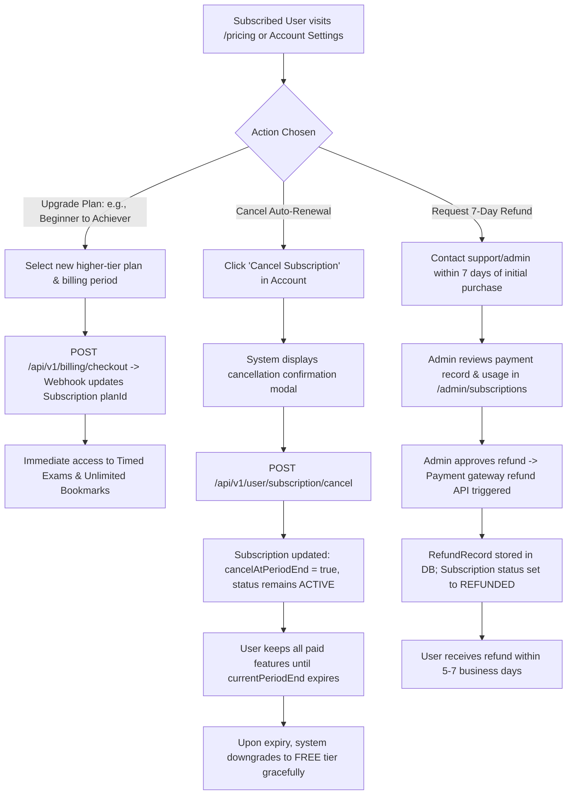

# User Flows and Application Journeys
## Platform: Pravaah UPSC
**Version:** 1.0.0  
**Author:** Antigravity UX Research & Engineering Team  

---

## 1. Overview of Key User Journeys
This document models the end-to-end navigational paths, decision branches, system events, and state mutations for both Aspirants and Administrators using Mermaid flowcharts and narrative specifications.

---

## 2. Flowchart 1: First-Time Visitor Journey & Onboarding

```mermaid
flowchart TD
    A[Visitor Lands on Homepage /] --> B{Action Chosen}
    B -->|Search Query| C[Type in Search Bar: e.g., 'Fundamental Rights']
    B -->|Browse by Paper| D[Click 'GS Paper 1' or 'GS Paper 2 (CSAT)']
    B -->|Browse by Year| E[Click Year Pill: e.g., '2024 (100)']
    B -->|Direct Sign In/Up| F[Click 'Sign In' or 'Sign Up Free']
    
    C --> G[Instant Question Search Results]
    D --> H[Prelims PYQ Explorer /pyqs]
    E --> H
    
    G --> I[Interact with Question in Learn Mode]
    H --> I
    
    I --> J{Clicks Option A/B/C/D}
    J --> K[Instant Visual Feedback: Green/Red + Explanation Unveils]
    K --> L{Wants to Bookmark or Save Progress?}
    L -->|Yes| M[Prompts Light-weight Registration / Login Modal]
    L -->|No| N[Continues Free Unrestricted Browsing]
    M --> O[Account Created / Session Initialized]
    O --> P[Bookmark Saved & Added to Personal Revision Queue]
```

### Explanation
- **Visitor Experience:** Zero forced walls. A student can land on Pravaah, immediately search for any topic or year, and solve questions right away in Learn Mode.
- **Conversion Moment:** When the student wants to save a bookmark, track historical accuracy, or launch a 2-hour timed test, the system smoothly prompts login/registration without losing the current question context.

---

## 3. Flowchart 2: Homepage to PYQ Discovery (Smart vs. Exact Keyword)



---

## 4. Flowchart 3: Year-Wise & Paper-Wise Question Browsing

```mermaid
flowchart TD
    A[User visits /pyqs] --> B[Default View: GS Paper 1, All Years]
    B --> C{User Selects Filters}
    C -->|Switch Paper| D[Toggle 'GS Paper 2 (CSAT)']
    C -->|Select Year Preset| E[Click 'Last 5 Years' or 'Last 10 Years']
    C -->|Select Specific Year| F[Toggle Year Chip: '2023', '2024']
    
    D --> G[URL updates: /pyqs?paper=GS2&years=2024]
    E --> G
    F --> G
    
    G --> H[Server / Client renders verified question list]
    H --> I[Displays Paper Code, Year, Question Number, Subject Badge]
```

---

## 5. Flowchart 4: Subject-Wise & Topic-Wise Practice



---

## 6. Flowchart 5: Learn Mode Question Interaction



---

## 7. Flowchart 6: Timed Examination Mode (Strict UPSC Simulation)

```mermaid
flowchart TD
    A[User visits /mock-tests or selects Full Paper] --> B[Configure Test: GS Paper 1 (100 Q, 120 Min) or CSAT (80 Q, 120 Min)]
    B --> C[User clicks 'Start Examination']
    C --> D[Server creates TestSession in DB; Strips all Answer Keys]
    D --> E[Full Screen Exam Interface Launched]
    
    E --> F[Countdown Timer Starts in Header]
    E --> G[Question Navigation Palette shows: Answered (Green), Unanswered (Gray), Marked for Review (Purple)]
    
    G --> H[User selects option -> Response autosaved to local state & server sync]
    G --> I[User clicks 'Mark for Review and Next']
    
    H --> J{Timer reaches 00:00 OR User clicks 'Submit Test'?}
    I --> J
    
    J -->|Confirmation Modal| K[User confirms final submission]
    K --> L[POST /api/v1/tests/session/submit with response payload]
    L --> M[Server calculates: Total, Correct, Incorrect, Unattempted, Net Score]
    M --> N[Redirects to /mock-tests/result/:sessionId]
    N --> O[Displays Comprehensive Performance Scorecard & Unlocked Solutions]
```

---

## 8. Flowchart 7: Bookmark, Notes & Revision Flow

```mermaid
flowchart TD
    A[User logged in] --> B{Trigger}
    B -->|Clicks Bookmark Icon on any Question| C[POST /api/v1/user/bookmarks]
    B -->|Clicks 'Add Note'| D[POST /api/v1/user/notes with custom text]
    B -->|Made a Mistake in Learn/Exam Mode| E[System flags UserAttempt.isCorrect = false]
    
    C --> F[Added to /bookmarks]
    D --> G[Persisted on Question Card & /notes]
    E --> H[Added to /revision ('Mistake Revision Queue')]
    
    H --> I[User visits /revision to drill failed questions]
    I --> J[Re-attempt question]
    J --> K{Is Re-attempt Correct?}
    K -->|Yes| L[Marks question as 'Mastered' and increments retention score]
    K -->|No| M[Keeps in active revision cycle with next review timestamp]
```

---

## 9. Flowchart 8: User Registration & Session Management



---

## 10. Flowchart 9: Learning Analytics & Performance Dashboard

```mermaid
flowchart TD
    A[User visits /dashboard] --> B[Fetch UserAttempt & UserResponse records for User ID]
    B --> C[Compute Overall Metrics: Total Attempts, Net Accuracy %, Study Hours]
    B --> D[Compute Subject Breakdown: Polity (84%), Economy (62%), Environment (48%)]
    B --> E[Identify 'Weak Areas': Topics with accuracy < 50%]
    B --> F[Fetch Active Revision Queue items]
    
    C --> G[Render Overview Stat Cards]
    D --> H[Render Interactive Subject Accuracy Bars]
    E --> I[Render 'Focus Areas' with direct link to practice those topics]
    F --> J[Render 'Quick Mistake Practice' card]
```

---

## 11. Flowchart 10: Admin Question Ingestion, Verification & Publication



---

## 12. Flowchart 11: Error and Recovery Flows



---

## 13. Flowchart 12: Plan Selection, Checkout & Payment Webhook Activation



---

## 14. Flowchart 13: Subscription Upgrade, Cancellation & Refund Policy


