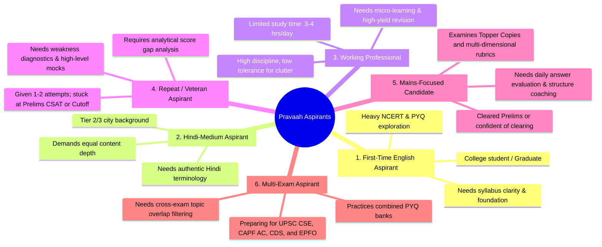
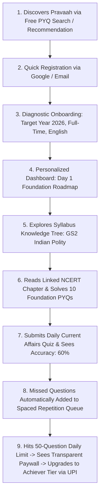
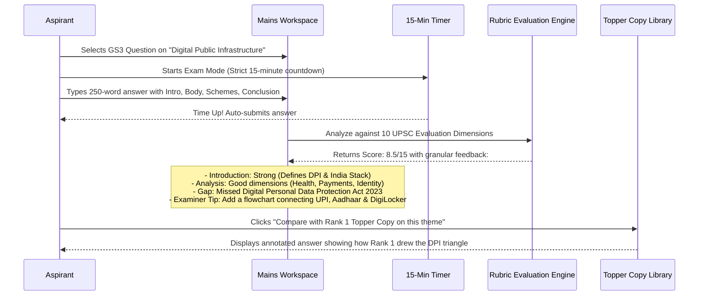

# PRAVAAH UPSC – COMPREHENSIVE USER JOURNEYS & ASPIRANT PERSONAS

**Document Version:** 1.0  
**Target:** Product Experience, Onboarding & Feature Workflow  
**Author:** Principal SaaS Product Architect & UPSC Academic Strategist  

---

## 1. ASPIRANT PERSONA PROFILES

Pravaah UPSC serves six distinct aspirant demographics, each with unique preparation timelines, constraints, and feature needs:



---

## 2. DETAILED END-TO-END JOURNEY MAPS

### Journey 1: The First-Time Aspirant (Syllabus to Readiness)



**Key Moments of Delight:**
- Viewing the official UPSC syllabus not as a dry PDF, but as an interactive visual tree where each branch has connected PYQs and NCERT chapters.
- Receiving immediate feedback on *why* an incorrect answer was wrong, citing the specific Constitutional Article or Supreme Court judgment.

---

### Journey 2: The Hindi-Medium Aspirant (देवनागरी प्रथम)

```mermaid
flowchart TD
    Land[1. Aspirant lands on Pravaah Homepage] --> LangSwitch[2. Clicks 'हिंदी' in Header Switcher]
    LangSwitch --> Persistent[3. Entire UI instantly renders in elegant Devanagari typography]
    Persistent --> Browse[4. Navigates to 'प्रारंभिक परीक्षा विगत वर्ष प्रश्न' (Prelims PYQs)]
    Browse --> Filter[5. Filters: 'भारतीय राजव्यवस्था' (Polity) > 'मूल अधिकार' (Fundamental Rights)]
    Filter --> Attempt[6. Solves 2023 Question in Hindi with authentic UPSC terminology]
    Attempt --> DualToggle[7. Unsure of complex phrase? Toggles 'English' button for instant English source check]
    DualToggle --> Video[8. Watches curated Hindi concept lecture in Video Academy]
    Video --> Success[9. Aspirant feels respected as a first-class user, not a second-class translated afterthought]
```

**Key Moments of Delight:**
- Academic terms are translated using official UPSC Commission terminology (e.g., *'संवैधानिक उपचार'*, *'मौलिक कर्तव्य'*, *'विधि द्वारा स्थापित प्रक्रिया'*).
- Zero broken layouts or awkward clipped text in Hindi mode.

---

### Journey 3: The Working Professional (High-Yield Micro-Learning)

- **Daily Budget:** 3.5 hours (1 hr morning commute + 0.5 hr lunch + 2 hrs evening).
- **Morning (08:00 - 09:00):** Opens Pravaah Mobile Web on the train. Reads the 5-minute **Daily Current Affairs** synthesis with pre-extracted GS-1/2/3/4 tags and attempts the **5-Question Daily Current Affairs Quiz**.
- **Lunch Break (13:15 - 13:45):** Solves 10 targeted CSAT or Economy questions from their **Spaced Repetition Revision Queue** on their smartphone.
- **Evening (20:30 - 22:30):** Sits at desktop. Opens **Mains Workspace**, selects today's editorial challenge question, sets the 15-minute timer, types 250 words, and receives an **instant 10-dimension AI evaluation** highlighting missed data points and structure gaps.

---

### Journey 4: The Mains Candidate (The Answer Writing Intensive)



---

## 3. USER ONBOARDING DIAGNOSTIC QUESTIONNAIRE (11 QUESTIONS)

To personalize the roadmap from second one, Pravaah guides every new user through an adaptive 11-step diagnostic:

1. **Target Examination:** `UPSC Civil Services (CSE)` / `CAPF (AC)` / `CDS` / `EPFO` / `State PSC`.
2. **Target Year:** `2025` / `2026` / `2027` / `Later`.
3. **Primary Preparation Medium:** `English` / `हिंदी (Hindi)`.
4. **Current Preparation Stage:** `Beginner (Starting from scratch)` / `Intermediate (Read standard books)` / `Advanced (Appeared in Prelims/Mains)`.
5. **Daily Available Study Time:** `Full-time (8-10 hours)` / `Moderate (5-7 hours)` / `Working Professional / College (2-4 hours)`.
6. **Self-Assessed Weakest Prelims Areas:** `CSAT` / `Economy` / `Environment & Sci-Tech` / `History & Culture` / `Polity` / `Current Affairs`.
7. **Optional Subject:** Selected from the 26 official UPSC optionals (e.g., PSIR, Geography, Sociology, Public Administration, History, Anthropology, Hindi Literature).
8. **Mains Answer Writing Experience:** `Never written an answer` / `Occasional practice` / `Written full test series`.
9. **Current Affairs Source:** `The Hindu` / `Indian Express` / `Monthly Magazines` / `Rely entirely on Pravaah`.
10. **Study Style Preference:** `Question-First (Practice and learn from mistakes)` / `Concept-First (Read/watch then test)`.
11. **Primary Motivation & Accountability Need:** `Strict daily schedule & reminders` / `Self-paced with analytics` / `Exam simulation only`.

---

## 4. PRODUCT RETENTION & HABIT LOOPS

Pravaah establishes daily study momentum through three psychological reinforcement mechanics:

1. **The UPSC Daily Streak:** Visual flame counter tracking consecutive days of answering at least 5 questions or reading daily current affairs.
2. **The Dynamic Readiness Index (0–100%):** A real-time proprietary score calculated from:
   - **Syllabus Coverage (30% weight):** Topics practiced across GS1-4.
   - **Prelims Accuracy (30% weight):** Rolling 30-day accuracy on standard-difficulty questions.
   - **Mains Answer Volume (20% weight):** Number of evaluated answers scoring >= 50%.
   - **Revision Hygiene (20% weight):** Cleared spaced repetition queue items.
3. **The "Next Best Action" Recommendation:** Every time the student opens their dashboard, Pravaah removes decision fatigue by presenting exactly one recommended task: *"Today's Priority: 15 Questions on Modern Indian History (1857-1947) to strengthen your 42% accuracy gap."*
