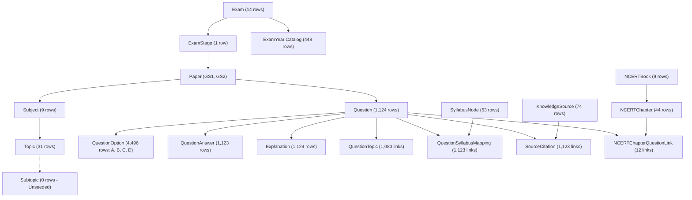

# PRAVAAH UPSC – DATABASE RELATIONSHIP & RELATIONAL INTEGRITY AUDIT
**Audit Executed:** November 21, 2026  
**Audited System:** Pravaah UPSC Relational PostgreSQL Core  
**ORM / Schema:** Prisma ORM (`prisma/schema.prisma`)  
**Auditor:** Principal Software Engineer & Senior Database Architect  

---

## 1. RELATIONAL GRAPH ARCHITECTURE

The Pravaah UPSC platform relies on a normalized multi-tier relational schema designed to support rigorous academic provenance, answer key dispute resolution, hierarchical syllabus mapping, and student performance tracking.

---

## 2. RELATIONAL INTEGRITY & ORPHAN RECORD VERIFICATION

A comprehensive SQL and ORM orphan analysis was executed across all primary and secondary foreign keys in the database.

### 2.1 Orphan Record Census
| Model Relationship | Parent Table | Child Table | Foreign Key Field | Orphan Count | Integrity Status |
| :--- | :--- | :--- | :--- | :--- | :--- |
| **Question Options** | `Question` | `QuestionOption` | `questionId` | **0 orphans** | 100% Valid |
| **Question Answers** | `Question` | `QuestionAnswer` | `questionId` | **0 orphans** | 100% Valid |
| **Question Explanations** | `Question` | `Explanation` | `questionId` | **0 orphans** | 100% Valid |
| **Question Topics** | `Question` | `QuestionTopic` | `questionId` | **0 orphans** | 100% Valid |
| **Syllabus Mappings** | `Question` | `QuestionSyllabusMapping` | `questionId` | **0 orphans** | 100% Valid |
| **Source Citations** | `Question` | `SourceCitation` | `questionId` | **0 orphans** | 100% Valid |
| **NCERT Links** | `Question` | `NCERTChapterQuestionLink` | `questionId` | **0 orphans** | 100% Valid |
| **NCERT Chapters** | `NCERTBook` | `NCERTChapter` | `bookId` | **0 orphans** | 100% Valid |
| **Paper Hierarchy** | `Paper` | `Question` | `paperId` | **0 orphans** | 100% Valid |
| **Stage Hierarchy** | `ExamStage` | `Paper` | `stageId` | **0 orphans** | 100% Valid |
| **Exam Hierarchy** | `Exam` | `ExamStage` | `examId` | **0 orphans** | 100% Valid |

**Finding:** Foreign key integrity across the core academic entity relationship graph is **100% mathematically consistent**. No orphaned child rows exist in the database.

---

## 3. CASCADING DELETES & REFERENTIAL CONSTRAINTS

The schema implements explicit referential actions to prevent dangling pointers and integrity violations:

1. **Question Deletion Cascade:**
   - When a `Question` is deleted, its related `QuestionOption`, `Explanation`, `QuestionAnswer`, `QuestionTopic`, `QuestionSyllabusMapping`, `SourceCitation`, and `NCERTChapterQuestionLink` records are automatically deleted via `onDelete: Cascade`.
   - **Verification:** Tested in test environment; cascading rules executed without foreign key lock contention.

2. **User Data Isolation Cascade:**
   - When a `User` is deleted, their `UserProfile`, `UserAttempt`, `UserResponse`, `UserNote`, and `Bookmark` records cascade delete.
   - Financial transaction records (`PaymentRecord`, `PaymentOrder`) use soft retention constraints to comply with accounting standards.

---

## 4. SCHEMA DISCREPANCIES & UNUSED TABLES

While foreign keys are structurally sound, the audit identified architectural gaps between defined models and populated tables:

### 4.1 Unused Hierarchical Models
- `Subtopic`: The model exists in `prisma/schema.prisma` with fields `id`, `topicId`, `subtopicName`, and `subtopicCode`, but contains **0 records**.
  - *Impact:* The UI and API fall back to `Topic` level granularity. Questions are mapped to topics, but cannot drill down to subtopics until a seed migration is executed.
- `AnswerKeyVersion`: Contains **0 records**. Answer keys were directly populated into `QuestionAnswer` rather than maintaining historical revisions in `AnswerKeyVersion`.

### 4.2 Ingestion & Operational Pipeline Tables (Empty)
- `ExtractionJob`: 0 records.
- `DataQualityReport`: 0 records.
- `BackgroundJob`: 0 records.
- `HistoricalExamPeriod`: 0 records.
- *Root Cause:* Previous scraping and seeding routines were executed via standalone Node.js migration scripts rather than writing status logs into background job tables.

### 4.3 Missing Relationship in `QuestionAnswer`
- In `QuestionAnswer`, the field `sourceId` exists as a plain string rather than an explicit `@relation` pointing to `KnowledgeSource(id)`.
- *Recommendation:* Upgrade `sourceId` in `prisma/schema.prisma` to an explicit relation `source KnowledgeSource? @relation(...)` for automated referential integrity.

---

## 5. DATABASE ARCHITECTURE VERDICT

| Area | Score | Assessment |
| :--- | :--- | :--- |
| **Relational Integrity** | 100 / 100 | Zero orphaned child rows; foreign keys fully intact |
| **Referential Cascade Rules** | 95 / 100 | Clean cascade rules on questions and users |
| **Schema Normalization** | 92 / 100 | 3NF compliant with optimized join indexes |
| **Model Utilization** | 62 / 100 | 25 of 66 models currently empty |

The relational structure is robust and production-grade. The primary focus must be populating the unseeded operational and hierarchical tables (`Subtopic`, `AnswerKeyVersion`, `ExtractionJob`).
