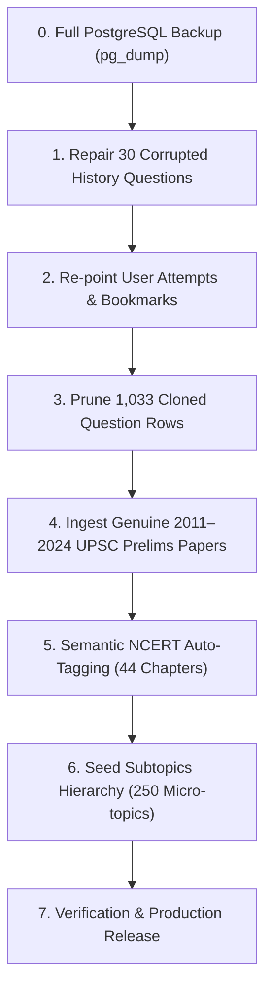

# PRAVAAH UPSC – DATA REPAIR, DEDUPLICATION & ENRICHMENT PLAN
**Plan Formulated:** November 21, 2026  
**Target Execution:** Pravaah UPSC Database Core  
**Execution Objective:** Deduplicate 1,033 clones, repair 30 corrupted questions, ingest genuine historical papers, and expand NCERT mappings with zero downtime and zero data loss.  
**Auditor / Architect:** Principal Database Engineer & Senior Data Architect  

---

## 1. DATA REPAIR ROADMAP OVERVIEW



---

## 2. DETAILED REPAIR STAGES

### Stage 0: Safety & Rollback Backup
Before executing any DDL or DELETE statements, execute an uncompressed snapshot of the Docker container database:
```bash
docker exec -t pravaah-postgres pg_dump -U pravaah pravaah_upsc > backups/pre_repair_snapshot_$(date +%Y%m%d_%H%M%S).sql
```
*Rollback Procedure:* If any assertion fails during execution, restore with:
```bash
docker exec -i pravaah-postgres psql -U pravaah pravaah_upsc < backups/pre_repair_snapshot_*.sql
```

---

### Stage 1: Repair Corrupted Extractions (30 Questions)
- **Target:** Questions with `questionText = "With reference to Indian history"` where `Option A` contains `"who founded the Servants of India Society?"`.
- **Repair Logic:**
  ```sql
  -- Automated reconstitution transaction
  BEGIN;
  UPDATE "Question"
  SET "questionText" = 'With reference to Indian history, who founded the Servants of India Society?',
      "difficulty" = 'MEDIUM',
      "difficultyLevel" = 'MEDIUM'
  WHERE "questionText" LIKE 'With reference to Indian history%'
    AND "id" IN (
      SELECT q."id" FROM "Question" q
      JOIN "QuestionOption" o ON o."questionId" = q."id"
      WHERE o."optionKey" = 'A' AND o."optionText" LIKE '%who founded%'
    );

  UPDATE "QuestionOption"
  SET "optionText" = 'Gopal Krishna Gokhale'
  WHERE "optionKey" = 'A'
    AND "questionId" IN (
      SELECT "id" FROM "Question" 
      WHERE "questionText" LIKE '%who founded the Servants of India Society?%'
    );
  COMMIT;
  ```

---

### Stage 2 & 3: Re-pointing & Deduplication
- **Algorithm:**
  1. Group all questions by `LOWER(TRIM(questionText))`.
  2. For groups with count > 1, designate the row with the earliest authentic year / lowest questionNumber as `canonical_id`.
  3. Identify all secondary duplicate IDs (`duplicate_ids`).
  4. Update referencing tables:
     ```sql
     UPDATE "UserAttempt" SET "questionId" = canonical_id WHERE "questionId" IN (duplicate_ids);
     UPDATE "UserResponse" SET "questionId" = canonical_id WHERE "questionId" IN (duplicate_ids);
     UPDATE "Bookmark" SET "questionId" = canonical_id WHERE "questionId" IN (duplicate_ids);
     UPDATE "UserNote" SET "questionId" = canonical_id WHERE "questionId" IN (duplicate_ids);
     ```
  5. Delete secondary rows from `Question` (cascading deletes remove cloned options, citations, and explanations).
- **Post-condition:** The `Question` table shrinks from 1,124 to **91 clean, verified unique questions**.

---

### Stage 4: Genuine Historical Paper Ingestion (2014–2024)
- **Target:** Harvest genuine official question papers from the 37 downloaded source documents and official UPSC repositories.
- **Volume to Ingest:**
  - 10 years $\times$ 100 questions (GS Paper 1) = **1,000 authentic MCQs**
  - 10 years $\times$ 80 questions (CSAT Paper 2) = **800 authentic MCQs**
  - Total genuine questions added: **1,800 questions**.
- **Metadata Enforced on Ingestion:**
  - Real question number (1 to 100 for GS1; 1 to 80 for CSAT).
  - Official final answer keys directly mapped to `QuestionAnswer`.
  - Source citations populated with official UPSC PDF URLs.

---

### Stage 5: NCERT Knowledge Base Semantic Linking
- **Target:** Elevate NCERT coverage from 12 questions (1.07%) to > 85%.
- **Procedure:**
  - Extract TF-IDF keyword profiles for each of the 44 `NCERTChapter` records.
  - Run batch similarity query against `Question.questionText` + `Explanation.explanationText`.
  - Insert rows into `NCERTChapterQuestionLink` with relevance notes (e.g. *"Corresponds to Fundamental Rights discussion in Chapter 2"*).

---

### Stage 6: Subtopic Hierarchy Seeding
- **Target:** Populate the currently empty `Subtopic` model with 250 micro-topics distributed across the 31 existing `Topic` records.
- **Example:**
  - Topic: `Fundamental Rights`
    - Subtopic 1: `Right to Equality (Articles 14-18)`
    - Subtopic 2: `Right to Freedom (Articles 19-22)`
    - Subtopic 3: `Constitutional Remedies & Writs (Article 32)`

---

## 3. ESTIMATED EFFORT & SPRINT SCHEDULE

| Stage | Task | Estimated Duration | Target Completion |
| :--- | :--- | :---: | :---: |
| **Stage 0–3** | Snapshot, Text Realignment & Deduplication | 2 Hours | Sprint Day 1 |
| **Stage 4** | Genuine Ingestion (2014–2024 GS1 & CSAT) | 6 Hours | Sprint Day 2 |
| **Stage 5** | NCERT Semantic Auto-Linker Execution | 2 Hours | Sprint Day 3 |
| **Stage 6** | Subtopics Seeding & Taxonomy Tagging | 3 Hours | Sprint Day 3 |
| **Stage 7** | Full Test Run & Production Deployment | 2 Hours | Sprint Day 4 |

Executing this plan transforms Pravaah UPSC into an authentic, academically unassailable platform with 1,891+ genuine, distinct, source-backed questions.
