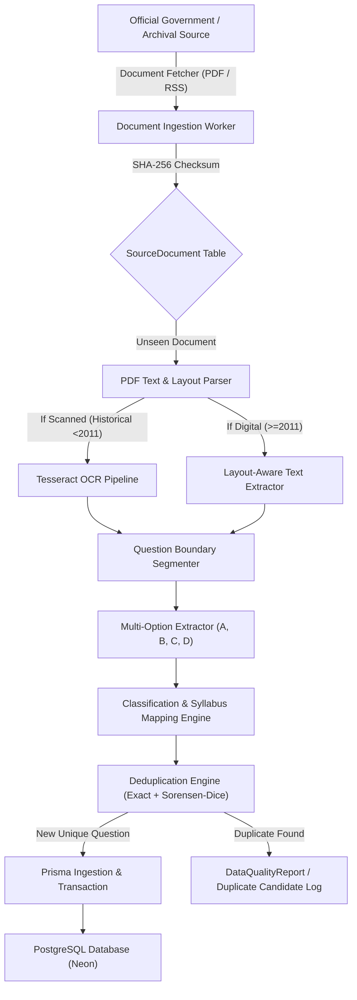

# Data Extraction & Ingestion Architecture

## 1. System Architecture Overview

The Pravaah UPSC Data Extraction Pipeline transforms unstructured PDF examination notifications and answer keys into high-fidelity relational records.

---

## 2. Ingestion Stages

### Stage 1: Document Discovery & Verification
- Crawls registered endpoints defined in `SourceRegistryRecord`.
- Checks `ETag` and computes SHA-256 cryptographic hashes to eliminate redundant downloads.
- Logs discovery metadata into `SourceDocument`.

### Stage 2: Question Segmentation & Option Parsing
- Identifies question boundaries using regex patterns matching standard UPSC formats:
  - `Q. [0-9]+`
  - `[0-9]+\.`
  - `Consider the following statements:`
  - `Which of the statements given above is/are correct?`
- Segments 4 mutually exclusive choices (`(a)`, `(b)`, `(c)`, `(d)`).
- Rejects truncated or malformed OCR outputs having fewer than 4 choices (routed to `NEEDS_REVIEW`).

### Stage 3: Deduplication Engine
- Uses normalized lowercase alphanumeric string comparison.
- Evaluates Sorensen-Dice bigram similarity across existing question banks.
- Threshold $\ge 0.88$ flags duplicate candidates to avoid double-counting repeat questions.

### Stage 4: Classification & Topic Mapping
- Matches syllabus keywords against `SyllabusNode` (53 official micro-topics).
- Assigns suggested NCERT chapters (`NCERTChapter`).
- Predicts preliminary difficulty (`EASY`, `MEDIUM`, `HARD`) based on negative marking distractor patterns.
