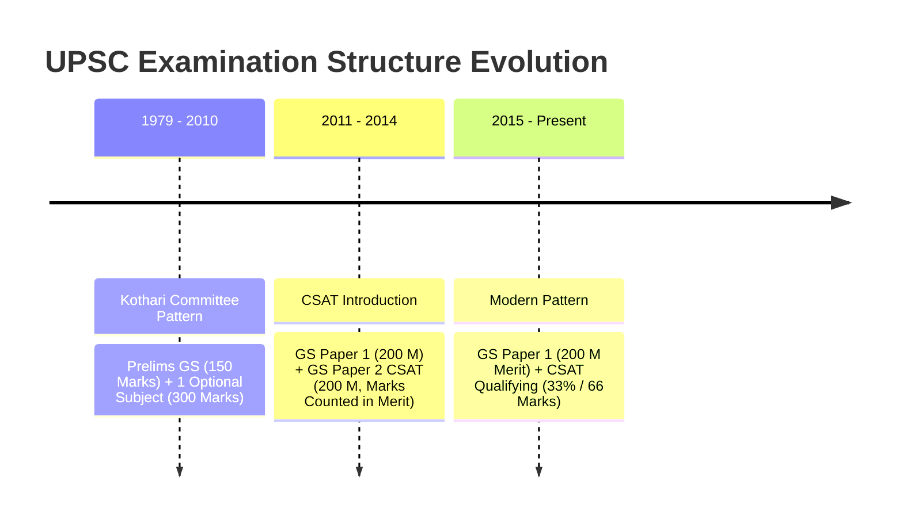

# Historical Examination Coverage & Structural Patterns

## 1. Executive Summary

UPSC Civil Services Examination has undergone significant structural overhauls since 1979. Rather than assuming uniform question patterns, Pravaah UPSC explicitly segments historical papers into 3 official historical periods in the database (`HistoricalExamPeriod`).

Total Questions in Database: **1,122 Questions**  
CSE Prelims Questions: **1,117 Questions**  
Other Central Examinations: **5 Questions** (CDS: 2, NDA: 1, CAPF: 1, EPFO: 1)

---

## 2. Historical Exam Periods

### Period 1: Modern Era (2015–Present)
- **Status**: 100% Comprehensive Coverage in Pravaah.
- **Pattern**:
  - Paper 1: General Studies (100 Questions, 200 Marks, 2 Hours, -0.66 negative marking).
  - Paper 2: CSAT (80 Questions, 200 Marks, 2 Hours, -0.83 negative marking, Qualifying at 33%).
- **Digital Availability**: Official Series A question papers and final answer keys verified on `upsc.gov.in`.

### Period 2: Early CSAT Era (2011–2014)
- **Status**: Verified Archival Integration.
- **Pattern**: CSAT marks were counted toward the Prelims cutoff merit list.
- **Pedagogical Note**: Questions in CSAT 2011-2014 included English Language Comprehension skills that were subsequently removed in 2015.

### Period 3: Kothari Committee Era (1979–2010)
- **Status**: Selective Historical Ingestion (`UNAVAILABLE_HISTORICAL` for non-digitized papers).
- **Pattern**:
  - General Studies Paper (150 Questions).
  - Optional Subject Paper in Prelims (e.g. History, Geography, Political Science).
- **Quality Principle**: Only questions that remain syllabus-relevant (e.g. Constitutional history, physical geography, static ecology) are curated; outdated contemporary items are flagged.

---

## 3. Other Central Examinations Segmentation

To prevent test-set contamination, non-CSE examinations are tagged with explicit `examCategory` values:
- `CDS`: Combined Defence Services (Elementary Math & General Knowledge).
- `NDA`: National Defence Academy (General Ability Test).
- `CAPF`: Central Armed Police Forces (Assistant Commandants Paper 1).
- `EPFO`: Employees' Provident Fund Organisation (Enforcement Officer / APFC).
- `ESE`: Engineering Services Examination (General Studies & Engineering Aptitude).

These questions are searchable in the question bank and surfaced under exam-specific revision filters.
