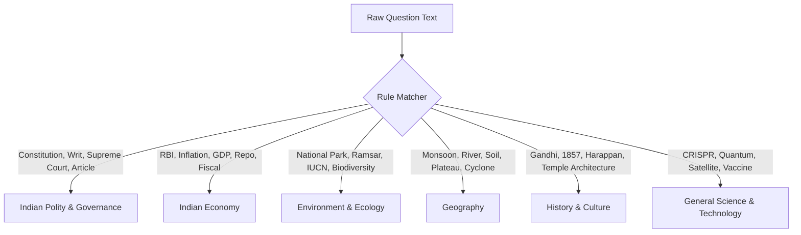

# Question Classification & Syllabus Mapping Guide

## 1. Classification Philosophy

UPSC CSE questions are frequently multi-disciplinary (e.g. an Agriculture question testing both Geography, Economics, and Environmental schemes). The Pravaah classification system assigns:
1. **Primary Subject** (e.g. `Indian Polity & Governance`)
2. **Primary Topic** (e.g. `Fundamental Rights & Judiciary`)
3. **Official Syllabus Node Code** (e.g. `PRE-POL-02`)
4. **Suggested NCERT Chapter** (e.g. `rights-in-the-indian-constitution`)
5. **Predicted Difficulty Tier** (`EASY`, `MEDIUM`, `HARD`)

---

## 2. Subject Rule Matrix

### Classification Rules Table

| Subject | Topic | Primary Trigger Keywords | Syllabus Node | Suggested NCERT |
|:---|:---|:---|:---|:---|
| Indian Polity & Governance | Fundamental Rights & Judiciary | `constitution`, `article`, `writ`, `supreme court`, `judicial review`, `habeas corpus`, `parliament` | `PRE-POL-02` | `rights-in-the-indian-constitution` |
| Indian Economy | Monetary & Fiscal Systems | `rbi`, `inflation`, `repo`, `monetary policy`, `gdp`, `fiscal deficit`, `balance of payments` | `PRE-ECO-02` | `money-and-banking` |
| Environment & Ecology | Biodiversity & Climate | `national park`, `wildlife`, `biodiversity`, `wetland`, `ramsar`, `unfccc`, `iucn`, `endangered` | `PRE-ENV-02` | `biodiversity-and-conservation` |
| Geography | Physical & Indian Geography | `monsoon`, `river`, `tributary`, `soil`, `himalaya`, `drainage`, `ocean current`, `cyclone` | `PRE-GEO-04` | `climate-india` |
| History & Culture | Modern & Ancient India | `gandhi`, `satyagraha`, `1857`, `british`, `harappan`, `buddhism`, `jainism`, `temple` | `PRE-HIS-03` | `mahatma-gandhi-and-the-nationalist-movement` |
| General Science & Tech | Emerging Tech & Space | `crispr`, `ai`, `quantum`, `satellite`, `isro`, `nasa`, `blockchain`, `vaccine`, `dna`, `rna` | `PRE-SCI-01` | `biotechnology-and-its-applications` |

---

## 3. Difficulty Estimation Heuristic

- `EASY`: Direct single-statement factual recall (e.g. "Tropic of Cancer passes through which states?").
- `MEDIUM`: Two-statement or three-statement combination questions where 1 option can be eliminated via basic syllabus coverage.
- `HARD`: "How many of the above pairs are correctly matched? (Only one, Only two, All three, None)" or questions involving minute nuances between statutory vs constitutional bodies.
