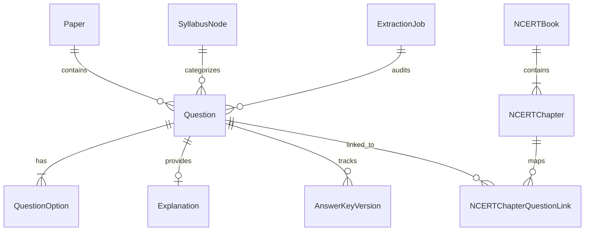

# Question Database Schema & Entity Relationships

## 1. Relational Entity Overview

The question bank schema in `prisma/schema.prisma` is architected for strict integrity, relational tracking between syllabus nodes, NCERT chapters, and official answer keys.

---

## 2. Core Entities

### `Question`
- `id`: CUID Primary Key.
- `paperId`: Foreign key to `Paper` (e.g. GS1, GS2).
- `year`: Integer examination year (e.g. 2024, 2018).
- `questionNumber`: 1-indexed order within paper.
- `questionText`: Markdown-formatted question stem.
- `difficulty`: `EASY` | `MEDIUM` | `HARD`.
- `status`: `PUBLISHED` | `DRAFT` | `NEEDS_REVIEW`.
- `examCategory`: `CSE` | `CDS` | `NDA` | `CAPF` | `EPFO` | `ESE`.
- `verificationStatus`: `OFFICIALLY_VERIFIED` | `COACHING_DISPUTED` | `UNAVAILABLE_HISTORICAL`.
- `verifiedAt`: Timestamp of editorial / key verification.

### `QuestionOption`
- `id`: CUID Primary Key.
- `questionId`: Cascade deletion on question delete.
- `optionCode`: `A` | `B` | `C` | `D`.
- `optionText`: Text of the option choice.
- `isCorrect`: Boolean indicator based on official Series A key.
- Unique Constraint: `[questionId, optionCode]`.

### `Explanation`
- `id`: CUID Primary Key.
- `questionId`: 1-to-1 unique relationship with `Question`.
- `summary`: High-level takeaway.
- `detailedExplanation`: Statement-by-statement evidence, statutory quotes, Supreme Court precedents.
- `eliminationTechnique`: Elimination heuristic / distractor diagnosis.
- `sourceCitation`: Direct reference to Ministry release, Gazette, or NCERT chapter.

### `NCERTChapterQuestionLink`
- `id`: CUID Primary Key.
- `chapterId`: Foreign key to `NCERTChapter`.
- `questionId`: Foreign key to `Question`.
- `relevanceNote`: Specific paragraph or diagram in textbook from which the question was framed.
- Unique Constraint: `[chapterId, questionId]`.
