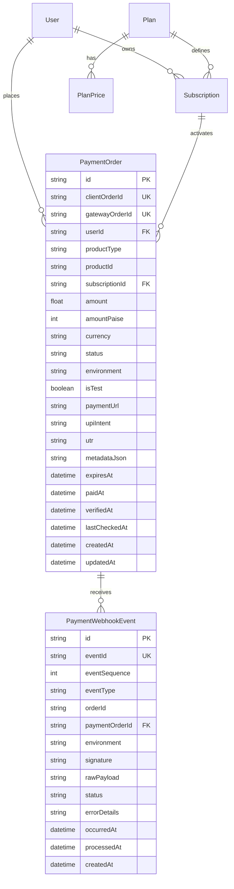
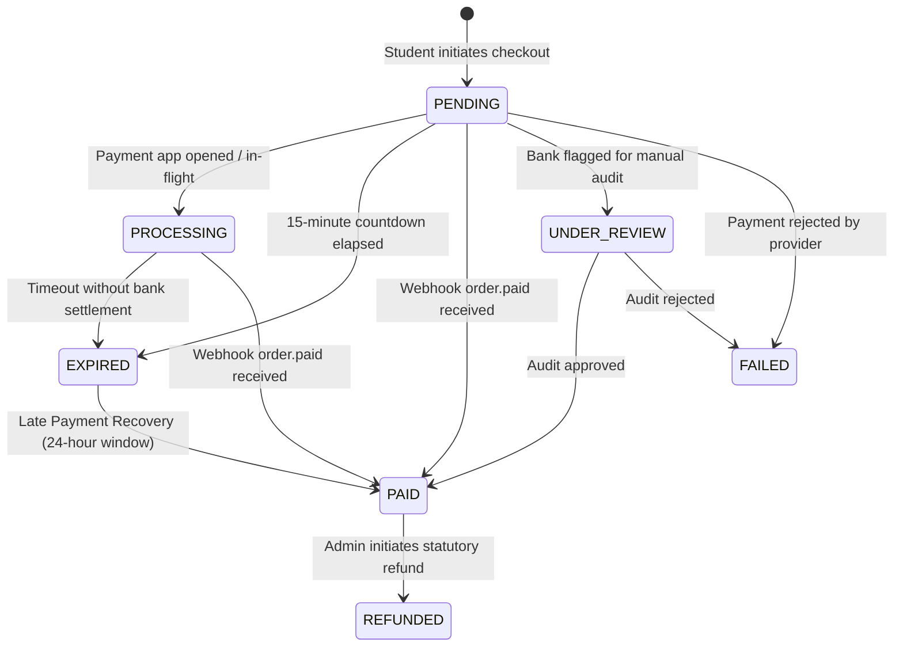

# Payment Database Design — Pravaah UPSC

## 1. Relational Entity Overview

The payment system extends Pravaah UPSC's PostgreSQL schema by introducing two dedicated models: `PaymentOrder` and `PaymentWebhookEvent`, while linking seamlessly to the existing `User`, `Plan`, `PlanPrice`, and `Subscription` models.

---

## 2. Table Specifications

### 2.1 `PaymentOrder` Table

| Column Name | Data Type | Modifiers / Constraints | Description |
|---|---|---|---|
| `id` | `VARCHAR(30)` | Primary Key (CUID) | Internal database identifier |
| `clientOrderId` | `VARCHAR(100)` | Unique, Not Null | Unique internal merchant order reference (`UPICHECKOUT_...`) |
| `gatewayOrderId` | `VARCHAR(100)` | Unique, Nullable | Gateway's external order ID (`ORD...`) |
| `userId` | `VARCHAR(30)` | Foreign Key -> `User(id)`, On Delete Cascade | Student who initiated the order |
| `productType` | `VARCHAR(50)` | Default `"SUBSCRIPTION"` | Product category (`SUBSCRIPTION`, `TEST_SERIES`, `MAINS_EVALUATION`, `COURSE`) |
| `productId` | `VARCHAR(100)` | Nullable | Identifier of purchased product (e.g. `"ACHIEVER"`, `"test-2024-gs1"`) |
| `subscriptionId`| `VARCHAR(30)` | Foreign Key -> `Subscription(id)`, On Delete SetNull | Provisioned subscription reference |
| `amount` | `DOUBLE PRECISION` | Not Null | Amount in Indian Rupees (e.g. `5499.00`) |
| `amountPaise` | `INTEGER` | Not Null | Amount in integer paise (e.g. `549900`) for precision accounting |
| `currency` | `VARCHAR(10)` | Default `"INR"` | ISO currency code |
| `status` | `VARCHAR(30)` | Default `"PENDING"` | Order lifecycle state |
| `environment` | `VARCHAR(20)` | Default `"sandbox"` | Environment flag (`"live"` or `"sandbox"`) |
| `isTest` | `BOOLEAN` | Default `true` | Sandbox transaction flag |
| `paymentUrl` | `TEXT` | Nullable | Gateway hosted checkout URL |
| `upiIntent` | `TEXT` | Nullable | Deep link string for mobile UPI applications |
| `utr` | `VARCHAR(100)` | Nullable | 12-digit Unique Transaction Reference from bank |
| `metadataJson` | `TEXT` | Nullable | Serialized context (billing interval, discount, items) |
| `expiresAt` | `TIMESTAMP(3)` | Nullable | Gateway payment window expiration timestamp |
| `paidAt` | `TIMESTAMP(3)` | Nullable | Timestamp when payment was confirmed |
| `verifiedAt` | `TIMESTAMP(3)` | Nullable | Timestamp of latest authoritative verification |
| `lastCheckedAt` | `TIMESTAMP(3)` | Nullable | Polling check timestamp |
| `createdAt` | `TIMESTAMP(3)` | Default `now()` | Record creation timestamp |
| `updatedAt` | `TIMESTAMP(3)` | Auto-updated | Record modification timestamp |

#### Indexes:
- `@@unique([clientOrderId])`
- `@@unique([gatewayOrderId])`
- `@@index([userId, status])`
- `@@index([status, createdAt])`
- `@@index([gatewayOrderId])`
- `@@index([clientOrderId])`

---

### 2.2 `PaymentWebhookEvent` Table

| Column Name | Data Type | Modifiers / Constraints | Description |
|---|---|---|---|
| `id` | `VARCHAR(30)` | Primary Key (CUID) | Internal ledger record ID |
| `eventId` | `VARCHAR(100)` | Unique, Not Null | Gateway UUID (`X-Event-Id` and `event_id`) |
| `eventSequence` | `INTEGER` | Nullable | Gateway transactional sequence number for out-of-order fencing |
| `eventType` | `VARCHAR(50)` | Not Null | Event name (`order.paid`, `order.expired`, `order.under_review`) |
| `orderId` | `VARCHAR(100)` | Nullable | Gateway order reference |
| `paymentOrderId`| `VARCHAR(30)` | Foreign Key -> `PaymentOrder(id)`, On Delete SetNull | Linked internal order |
| `environment` | `VARCHAR(20)` | Default `"sandbox"` | Event environment (`live` or `sandbox`) |
| `signature` | `VARCHAR(255)` | Nullable | Received `X-Signature` header value |
| `rawPayload` | `TEXT` | Not Null | Complete, byte-exact request JSON string for auditability |
| `status` | `VARCHAR(30)` | Default `"PROCESSED"` | Ingestion state (`PROCESSED`, `IGNORED`, `FAILED`) |
| `errorDetails` | `TEXT` | Nullable | Error traceback if processing failed |
| `occurredAt` | `TIMESTAMP(3)` | Nullable | Timestamp event occurred on gateway |
| `processedAt` | `TIMESTAMP(3)` | Default `now()` | Ingestion timestamp |
| `createdAt` | `TIMESTAMP(3)` | Default `now()` | DB insertion timestamp |

#### Indexes:
- `@@unique([eventId])`
- `@@index([orderId, eventType])`

---

## 3. Order Lifecycle State Machine

### State Definitions:
- **`PENDING`**: Initial state upon order creation. Dynamic QR and intent links are active.
- **`PROCESSING`**: Gateway has registered an incoming connection or pending confirmation.
- **`PAID`**: Terminal success state. Authoritative settlement verified via webhook HMAC or verified status API. Entitlement activated.
- **`EXPIRED`**: Window expired without bank credit. QR code is invalidated.
- **`UNDER_REVIEW`**: Payment received but flagged by bank risk engine for manual UTR reconciliation.
- **`FAILED`**: Explicit decline by user's bank or UPI handle.
- **`REFUNDED`**: Order has been returned to aspirant.
