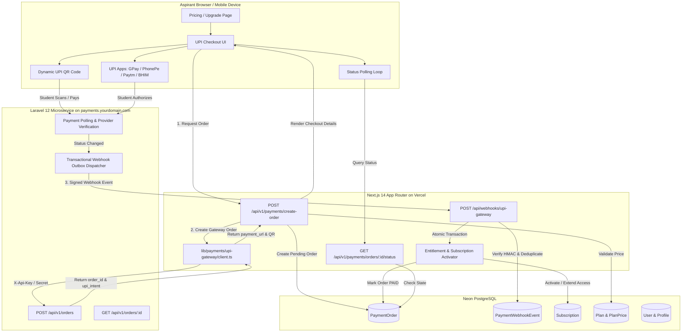
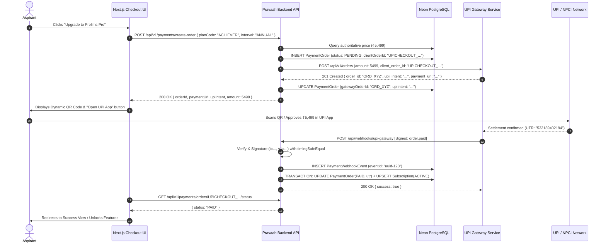

# UPI Gateway Architecture — Pravaah UPSC

## 1. System Overview & Component Separation

---

## 2. Component Design & Responsibilities

### 2.1 Next.js Client Layer
- **Responsibility**: Provides a responsive, distraction-free UPI checkout view consistent with the Pravaah UPSC design system.
- **Key Modules**:
  - `CheckoutUI`: Renders order summary, countdown timer, dynamic QR code, and UPI intent action buttons.
  - `StatusPoller`: Periodically requests `/api/v1/payments/orders/[orderId]/status` every 3 seconds until a terminal state (`PAID`, `FAILED`, `EXPIRED`) is reached.
  - `IntentLauncher`: Direct links for mobile browsers (`upi://pay?...`) targeting installed UPI applications (Google Pay, PhonePe, Paytm, CRED, BHIM).

### 2.2 Next.js Server Layer (`lib/payments/upi-gateway/`)
- **`config.ts`**:
  - Reads environment variables with strict runtime validation (`UPI_GATEWAY_BASE_URL`, `UPI_GATEWAY_API_KEY`, `UPI_GATEWAY_API_SECRET`, `UPI_GATEWAY_WEBHOOK_SECRET`, `UPI_GATEWAY_SANDBOX_MODE`).
  - Distinguishes between Live and Sandbox URLs and signing secrets.
- **`client.ts`**:
  - Encapsulates `fetch` with 10-second connection timeouts, error normalization, and request/response logging (with credentials scrubbed).
- **`create-order.ts`**:
  - Orchestrates price validation, internal order reference generation (`UPICHECKOUT_...`), gateway order initiation, and database persistence.
- **`verify-status.ts`**:
  - Calls `GET /api/v1/orders/{id}` to synchronize status when webhooks are delayed or when the client polls.
- **`webhook-verification.ts`**:
  - Performs regex extraction of `t=` (timestamp) and `v1=` (signature), evaluates the 5-minute replay window, and performs constant-time byte comparison using `crypto.timingSafeEqual`.
- **`types.ts` & `errors.ts`**:
  - Strongly typed TypeScript interfaces and domain-specific error classes (`UpiGatewayApiError`, `WebhookVerificationError`, `OrderNotFoundError`).

### 2.3 Database Tier (Prisma + PostgreSQL)
- **`PaymentOrder` Table**:
  - Master order record containing student ID, internal reference (`clientOrderId`), gateway order ID (`gatewayOrderId`), product details, amount in INR and paise, status (`PENDING`, `PROCESSING`, `PAID`, `FAILED`, `EXPIRED`, `UNDER_REVIEW`, `REFUNDED`), and expiry timestamps.
- **`PaymentWebhookEvent` Table**:
  - Durable ledger storing incoming `X-Event-Id` UUIDs, event sequence counters, raw request bodies, and processing results. Unique constraint on `eventId` guarantees idempotency.

### 2.4 External UPI Gateway Service
- Deployed independently on a dedicated VPS or containerized platform.
- Handles direct bank polling, dynamic QR payload generation, and UTR reconciliation.
- Queues events into a durable MySQL webhook outbox and retries deliveries with exponential backoff.

---

## 3. End-to-End Payment Flows

### 3.1 Standard Payment Success Flow

### 3.2 Late Payment Recovery Flow
Aspirants occasionally complete bank authentication slightly after the 15-minute countdown expiry.
- If the gateway receives confirmed settlement within its 24-hour late recovery window, it dispatches an `order.paid` event.
- Pravaah UPSC's webhook handler checks if the order was previously marked `EXPIRED`.
- The handler executes the transition `EXPIRED -> PAID`, updates the UTR, logs an audit event, and activates the subscription.
- This ensures no aspirant loses money or access due to transient network lag during bank verification.

---

## 4. Idempotency & Fault-Tolerance Principles

1. **At-Least-Once Delivery Resilience**:
   The gateway delivers webhooks at least once; duplicate deliveries are anticipated. By storing `X-Event-Id` in `PaymentWebhookEvent` with a unique index, subsequent deliveries for the same event ID return `200 OK` with `{ message: "Webhook already processed idempotently" }` without re-executing entitlements.
2. **Out-of-Order Sequence Safety**:
   Each gateway webhook payload includes an `event_sequence` integer. If an older `order.expired` (sequence 1) arrives after a late `order.paid` (sequence 2), the handler detects the sequence and refuses to revert `PAID` back to `EXPIRED`.
3. **Database Transaction Isolation**:
   Payment status updates and subscription activations run in an atomic `prisma.$transaction`. If subscription provisioning fails, the payment status change rolls back.
