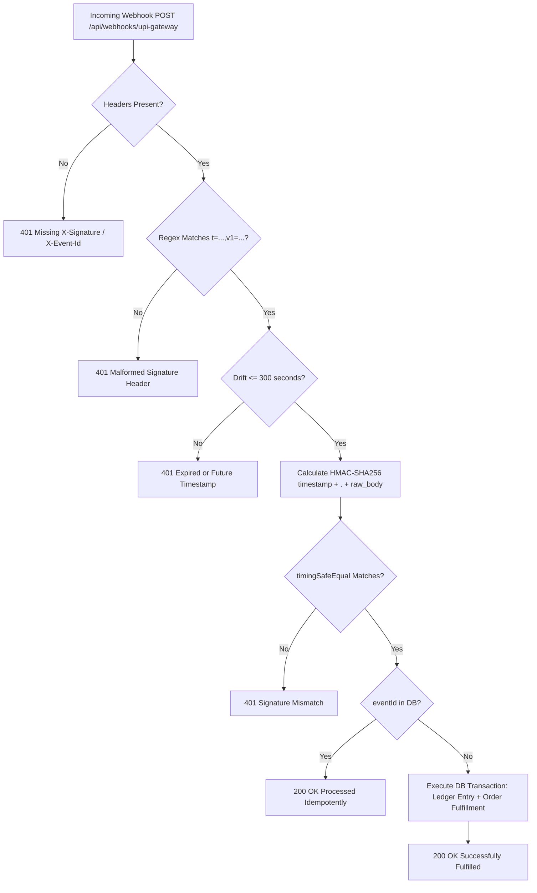

# Webhook Security Specification — Pravaah UPSC

## 1. Webhook Protocol & Threat Model

The UPI Gateway dispatches asynchronous notifications to notify Pravaah UPSC of real-time payment state transitions (`order.paid`, `order.expired`, `order.under_review`). Because webhook endpoints are exposed over the public internet, they must be fortified against eavesdropping, forged payloads, replay attacks, timing analysis, and race conditions.



---

## 2. Cryptographic Header Verification

### 2.1 Header Format
Every webhook request contains:
```http
X-Signature: t=1731718452,v1=5d41402abc4b2a76b9719d911017c592b23a7431e3458a2d1e23f4a21098bca1
X-Event-Id: 00000000-0000-4000-8000-000000000001
X-Event: order.paid
Content-Type: application/json
```

### 2.2 Signature Construction
The signature is computed as:
$$\text{Signature} = \text{HMAC-SHA256}(\text{Secret}, \, \text{timestamp} \mathbin{\Vert} \text{"."} \mathbin{\Vert} \text{rawBody})$$
Where:
- `timestamp`: The Unix epoch seconds extracted from the `t=` parameter.
- `rawBody`: The exact, unparsed UTF-8 request payload string.
- `Secret`: The merchant webhook secret configured in `UPI_GATEWAY_WEBHOOK_SECRET`.

### 2.3 Constant-Time Comparison
To protect against side-channel timing attacks, comparison is executed using Node.js `crypto.timingSafeEqual`:
```typescript
const sigBuffer = Buffer.from(signature, "hex");
const expectedBuffer = Buffer.from(expectedSignature, "hex");

if (sigBuffer.length !== expectedBuffer.length) {
  return { isValid: false, error: "Signature length mismatch" };
}

const isMatch = crypto.timingSafeEqual(sigBuffer, expectedBuffer);
```

---

## 3. Replay Protection & Clock Drift

- **Maximum Allowed Tolerance**: 300 seconds (5 minutes).
- Requests where $|\text{now} - \text{timestamp}| > 300$ are rejected with HTTP 401.
- This prevents an attacker from intercepting a historical valid payload and re-transmitting it to trigger unauthorized actions.

---

## 4. Idempotency & Webhook Deduplication

1. **Transactional Event Ledger**:
   - Every verified webhook inserts a record into the `PaymentWebhookEvent` table with a unique constraint on `eventId`.
2. **Repeated Deliveries**:
   - Network timeouts between the gateway and Pravaah may cause the gateway to retry delivery.
   - Upon encountering an existing `eventId`, the endpoint immediately returns HTTP 200 with `{ message: "Webhook event already processed idempotently" }` without re-executing entitlement activation.

---

## 5. Sequence Safety & Late Payment Recovery

### 5.1 Out-of-Order Deliveries
Due to concurrent queue workers on the gateway, `order.expired` (sequence 1) may arrive after `order.paid` (sequence 2).
- The handler inspects current order status:
  ```typescript
  if (eventType === "order.expired" && order.status === "PAID") {
    // IGNORED: Paid state is never downgraded to expired
  }
  ```

### 5.2 Late Recovery Window
If an aspirant pays after the initial 15-minute countdown and the bank credits the funds within the gateway's 24-hour late recovery window, the gateway dispatches `order.paid`.
- The handler transitions `EXPIRED -> PAID`, records the bank UTR, and provisions the subscription. No student is denied access for delayed banking confirmations.

---

## 6. Secret Isolation & Environment Safety

- Separate secrets are maintained for Sandbox and Production:
  - Live: `UPI_GATEWAY_WEBHOOK_SECRET` (configured via secure Vercel environment variables).
  - Sandbox: Defaults to isolated test secret.
- Webhook payloads originating from Sandbox environments are flagged with `isTest: true` and cannot activate real-money entitlements in production.
